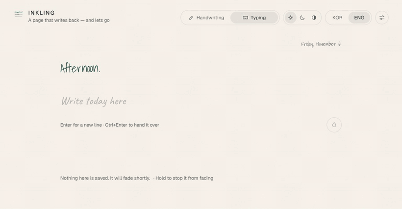
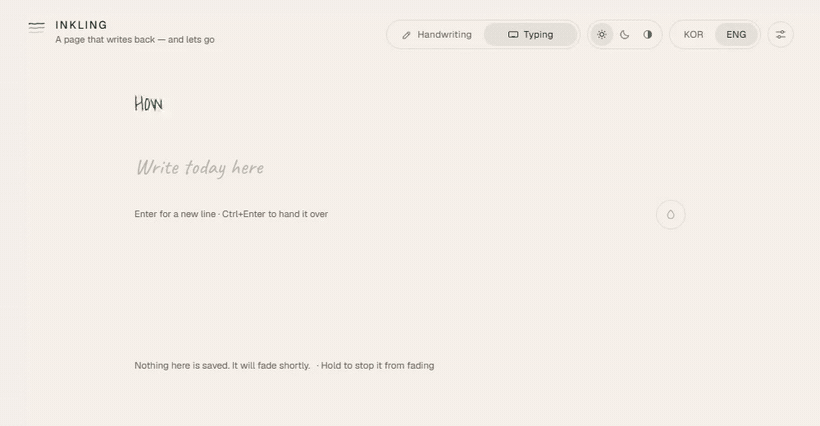
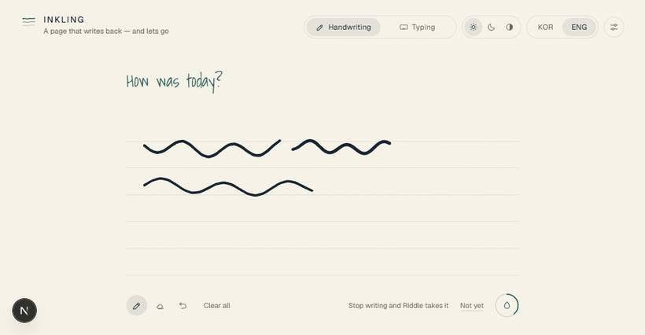

<div align="center">


# Inkling

**A page that writes back — and lets go.**

Write down your day. Something answers in its own handwriting, at the speed of a hand.<br/>
Then both of you fade off the paper, and nothing is kept.

[](https://nextjs.org)
[](https://react.dev)
[](https://www.typescriptlang.org)
[](https://tailwindcss.com)
[](https://developers.openai.com/api/docs/models/gpt-5.4-mini)
[](#-accessibility-is-the-hard-part)
[](LICENSE)



</div>

> [!NOTE]
> Every recording on this page runs in real time, at the app's own pace. The
> clips are sped up slightly so a README stays a README.

---

## 🕯️ What this is

Every conversational AI keeps everything. That is useful, and it is also not the only
possible shape.

Inkling is the other one. You write — by hand or by keyboard — and a page writes back.
It writes the way a person writes: character by character, pausing at commas, pressing
harder at the start of a stroke. Then, after a while, the ink thins and goes, taking
your words with it. Nothing is saved to a server. Nothing survives closing the tab.

The hypothesis it exists to test: **a guarantee of disappearance lowers the threshold
for saying the thing.**

---

## 📖 Always a blank page

The film this borrows from never lets two things share the paper. You write, the
words sink in, the answer surfaces, and by the time you have read it the sheet is
empty again.

<div align="center">

<br/>
<sub><i>Hand it over · it sinks · the page reads · it answers · you read · gone.</i></sub>
</div>

The reply's dwell is not a fixed number — it is a **reading estimate**, weighted by
script so that Korean and English of equivalent content get equal time on the page.
If you would rather the exchange stayed together, **Keep the exchange** in settings
restores the older behaviour, and **Never fade** turns the whole thing off.

---

## ✨ Features

|   | |
|---|---|
| 📖 | **Blank-page mode.** What you hand over sinks in at once; the reply leaves about the time you finish reading it |
| ✍️ | **Two hands, one page.** Write with a stylus, a finger, or a keyboard — toggle at any time |
| 🪶 | **Real handwriting animation.** Per-grapheme reveal in Korean and English, with a nib riding the stroke |
| 🖋️ | **Four handwriting faces**, each a Latin face paired with a Hangul one, chosen separately for you and for the page |
| ✏️ | **Hand-drawn marks.** Underlines that flick, circles that overshoot their own start, a highlighter pass |
| ⏱️ | **Hand-over you can see coming.** Stop writing and a ring fills; any new stroke puts it back to zero |
| ⏸️ | **Time that waits for you.** The clock stops while you write, while the tab is hidden, and while you hold the paper |
| 🌗 | **Light · dark · system**, resolved server-side so nothing flashes |
| 🌏 | **한국어 / English**, including the page's own handwriting |
| 🔒 | **No database, no logs, no history.** Context lives in the tab and dies with it |
| ♿ | **Zero axe violations** across six page, theme and mode combinations |

---

## 🚀 Quick start

```bash
git clone https://github.com/Soohwan-Lee/riddle-diary-web.git
cd riddle-diary-web
npm install
cp .env.example .env.local     # optional — see below
npm run dev
```

Open <http://localhost:3000>.

**No API key? It still runs.** Without `OPENAI_API_KEY` the route serves canned replies
at a realistic streaming cadence, so the whole interaction — writing, marks, fading — is
fully explorable at zero cost. A missing key is never a 500.

### Environment

| Variable | Required | Notes |
|---|---|---|
| `OPENAI_API_KEY` | no | Server-only. Absent ⇒ mock mode |
| `OPENAI_MODEL` | no | Defaults to `gpt-5.4-mini`. Must support image input and the Responses API |
| `MOCK_AI` | no | `1` forces mock mode even with a key present |

### Deploy

[](https://vercel.com/new/clone?repository-url=https%3A%2F%2Fgithub.com%2FSoohwan-Lee%2Friddle-diary-web&env=OPENAI_API_KEY&envDescription=Optional%20—%20leave%20blank%20to%20run%20in%20mock%20mode)

Zero configuration. The one endpoint runs on the Node runtime with a 60s ceiling, which
streaming makes irrelevant — time to first character is under a second.

### Scripts

```bash
npm run dev        # dev server
npm run check      # typecheck + lint + tests — run before committing
npm run build      # production build
npm run test       # Vitest
```

---

## 🖋️ How the ink works

The interesting problem: **you cannot animate Hangul handwriting the way tutorials
animate signatures.**

The usual trick is `stroke-dashoffset` along a font's outline. That traces the *contour*
of a letter, not the letter — it looks like someone shading in an outline, and it needs
per-glyph stroke data that simply does not exist for 11,172 Hangul syllables.

So Inkling runs **two backends on one clock**:

| What | Technique | Why |
|---|---|---|
| **Text** | Per-grapheme animated `clip-path` over a real handwriting face | Works identically in Korean and English, at any font size, for any string |
| **Marks** | `stroke-dashoffset` along a generated path | These *have* real paths, so the pen genuinely moves |

What sells the illusion is the timing, not the technique:

- **Per-character duration** from script and stroke count — a Hangul syllable is three or
  four strokes stacked into one square, so it takes longer than an `a`. Weights shape the
  rhythm; the total is then normalised, so `cpm` means the same thing in every script.
- **±18% jitter** from a seeded hash. Irregular, but frozen per character — a re-render
  must never make the line twitch.
- **Pen lifts** after spaces, longer rests at commas and full stops. The page appears to
  think mid-sentence.
- **A nib** riding the edge of the reveal. It is a pseudo-element animation on every
  character rather than one tracked node, which buys the effect for zero rAF loops and
  zero layout reads.
- **Wet ink** that dries to its resting tone over the following second.

Marks are drawn *after* the sentence is finished, the way a person marks. A hand-drawn
circle's giveaway is that it passes its own starting point instead of meeting it, so it
sweeps 1.08 turns.

### Streaming into a hand

A model streams faster than a hand writes. Characters therefore **mount when their turn
comes** rather than carrying CSS delays — that is what lets a growing reply extend a node
without re-timing the words already on the paper.

### Fading

One CSS animation per word, staggered in writing order, with its play state driven by an
inherited `--fade-state` custom property. Pausing the entire page is a single variable
write. Clean-up hangs off `animationend` rather than a timer, so a paused fade also
pauses its own removal.

**Measured:** 3,504 character spans and 6,066 DOM nodes render at a **16.7ms median
frame**, p95 16.8ms, two frames over 32ms out of 590.

### Four hands

Each hand is a Latin face plus a Hangul one, so a line that mixes scripts still reads as
one person wrote it — the Latin face comes first in the stack and Hangul falls through by
unicode-range.

| Hand | Latin | Hangul |
|---|---|---|
| Ballpoint | Caveat | Gaegu |
| Nib | Shadows Into Light | Nanum Pen Script |
| Brush | Kalam | Nanum Brush Script |
| Print | Patrick Hand | Hi Melody |

These faces disagree about x-height, so each carries a scale factor; the correction lives
on `.ink-line` rather than the node, which keeps `1em` resolving to the size the caller
asked for. The choice travels in a cookie next to the theme, so a chosen hand is there in
the first paint instead of swapping in after hydration.

---

## 🤝 The conversation



### Knowing when it leaves your hands

Handwriting has no Enter key, and the old build hid the hand-over button until a stroke
existed — so there was nothing to discover and then nothing happened. Now the button is
always there, dimmed until there is something to give it. **Stop writing and a ring fills
around it over four seconds, then the page takes the entry.** Every stroke, erase and undo
puts the ring back to zero, and **Not yet** drops that entry to manual for as long as you
like.

The ring is deliberately excluded from the `prefers-reduced-motion` shortening that every
other animation gets: a countdown that completes instantly is a lie about when your
writing leaves.

Handwriting is sent to `gpt-5.4-mini` as an image — no OCR service, and Korean and English
both just work. The model reads it and replies in one call, emitting a single leading
`READ: …` line with its transcription. The server splits that off the token stream: it
becomes conversational context, but it is **never drawn**, so what stays on the page is
your hand, not a machine's rendering of it.

Marks travel as inline markup inside the stream, so they can be parsed incrementally:

```
__text__     underline
((text))     circle it
==text==     highlighter
```

The parser has one hard requirement — **the plain text it emits must be a stable prefix**.
A character already written can never move or disappear. An unclosed opener is therefore
treated as a mark that is still growing, not as literal text.

### Who answers

Not a coach, not a therapist, not an assistant. It listens, it does not advise, and it
usually copies out one exact fragment of what you wrote so you can see it from outside.
Replies are one to three sentences — **not to save tokens, but because something writing
by hand cannot write much.** The constraint is the product.

The system prompt is in [`src/lib/ai/prompt.ts`](src/lib/ai/prompt.ts) and is worth
reading; it is more of the design than the CSS is.

---

## ♿ Accessibility is the hard part

Text that vanishes is an accessibility problem, and the honest answer is not to shrug at
it:

- The **full conversation stays in a live region** that never fades. A screen reader user
  is never asked to race an animation. This matters more in blank-page mode than it did
  before, and it was already the answer.
- A first visit gets **three sentences** saying what this is, that it disappears, and how
  to hold it. Not a modal — someone who ignores it and starts writing has understood it.
- `prefers-reduced-motion` drops the writing animation. Ink still fades — that is the
  idea, not the decoration — just more gently and without blur.
- **Hold anywhere on the paper and time stops.** Fading can also be switched off entirely.
- Time also stops while the tab is hidden and while you are mid-sentence. You will never
  come back to a blank sheet.
- Handwriting mode does not pretend to be keyboard-operable. It says it needs a pointer
  and points at typing mode, rather than trapping a screen reader in a `role="application"`
  surface with nothing to do.

Audited with axe (`wcag2a`, `wcag2aa`, `wcag21a`, `wcag21aa`, `best-practice`) across home
light/dark/handwriting, `/about` light/dark, and the settings sheet: **0 violations**.

---

## 🔐 Privacy, honestly

| | |
|---|---|
| Server storage | **None.** No database, no session store, no files |
| Server logs | Error *shape* only (`APIError 429`) — never a message, which could quote your words |
| Conversation context | In the memory of your browser tab. Reload or close it and it is gone, with no recovery offered |
| Browser storage | Settings only: theme, language, input mode, handwriting faces, page mode, fade pace, writing speed, and whether you have seen the opening note |
| Third parties | The OpenAI API, and only when you have configured a key |

Rate limiting is an in-process token bucket, and its limits are honest: it stops one tab
hammering the endpoint, but each serverless instance keeps its own bucket. For real
exposure, put a shared store behind it —
[`@upstash/ratelimit`](https://github.com/upstash/ratelimit) drops into
[`src/lib/ratelimit.ts`](src/lib/ratelimit.ts) with no other changes.

> [!IMPORTANT]
> Inkling is **not** a medical or counselling service and does not replace diagnosis or
> treatment. Crisis resources are one tap away from anywhere in the app.
> 🇰🇷 자살예방상담전화 **109** · 정신건강위기상담전화 **1577-0199** ·
> 🌐 **988** (US/CA) · **116 123** (UK) · [findahelpline.com](https://findahelpline.com)

---

## 🔬 Research framing

This began as a design-research question rather than a product idea, and
[`/about`](src/lib/i18n/about.ts) states the position in the app itself.

- **Slow Technology** (Hallnäs & Redström, 2001) — technology not aimed at efficiency,
  where producing time for reflection is the function. There is no skip button. In the
  fifteen seconds a reply takes, you re-read the sentence you just wrote.
- **Critical Design** (Dunne & Raby) — a counter-proposal to accumulation as the default.
- **Expressive writing** (Pennebaker) — the clinical effect of putting an event into words.
- **Materiality** — typing is uniform; handwriting keeps hesitation as a wobble and feeling
  as pressure. The two modes sit side by side as a toggle so the difference is observable.

[`docs/PLAN.md`](docs/PLAN.md) is the working plan, including a section on where the build
diverged from it and why.

---

## 🗺️ Roadmap

- [ ] **Diagrams.** The model emits a node/edge spec; the same `stroke-dashoffset` engine
      draws it. The `{ kind: 'path' }` case already exists
- [ ] A single-stroke font backend for Latin text, promoting it to the true stroke engine
- [ ] Page turns, paper textures, an optional nib sound
- [ ] An end-of-session ritual: keep one sentence, burn the rest
- [ ] Writing rhythm — speed, pressure, pauses — as an affective signal, **only** behind a
      designed research-consent flow

---

## 🧱 Layout

```
src/
├─ app/
│  ├─ api/converse/   the only server endpoint — SSE, stateless
│  ├─ about/          the research note
│  ├─ lab/            ink engine testbed
│  ├─ icon.*          the mark, as favicon / PWA icon / social card
│  ├─ ink.css         the animation layer
│  └─ globals.css     design tokens, themes, the four hands
├─ components/
│  ├─ ink/            InkText, InkStrokes, MarkLayer, the reveal scheduler
│  ├─ page/           Diary, Composer, InkCanvas, IntroNote, Transcript
│  └─ chrome/         header, toggles, hand picker, settings sheet
├─ lib/
│  ├─ ink/            segmentation, timing, dwell, mark geometry, strokes
│  ├─ ai/             prompt, InkScript parser, reading splitter, transport
│  ├─ i18n/           ko/en dictionaries
│  └─ prefs/          cookie + localStorage preferences
└─ store/session.ts   turns (fade away) and history (does not)
```

Every icon in the app — favicon, PWA icon, social card — is rendered from the one drawing
in [`docs/media/mark.svg`](docs/media/mark.svg): three written lines thinning out, and a
nib still resting on the first.

Pure logic is unit-tested — segmentation, timing, geometry, the incremental parser, the
rate limiter. The animation itself is verified by looking at it, against `/lab`.

---

## 📄 License

[MIT](LICENSE).

Inspired, at a distance, by a diary in a film that wrote back. That one was a manipulator;
this one holds still.
