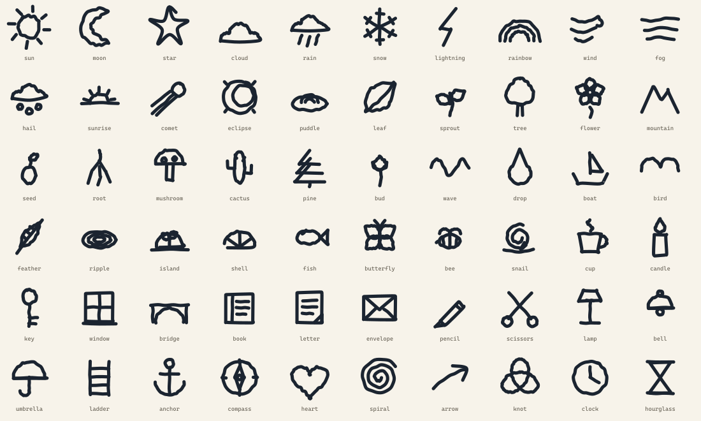

<div align="center">


# Inkling

**A page that writes back — and lets go.**

A critical design artifact about what a diary could be if it were designed to forget you.

Write by hand or by keyboard. Riddle answers in its own handwriting, at the pace of a
hand. Then both of you fade off the paper, and nothing is kept.

[](#the-diary-that-writes-back)
[](#research-framing)
[](#the-interface-is-the-argument)
[](#accessibility-is-the-hard-part)
[](LICENSE)


</div>

> **The diary remembers nothing. It is still listening.**

> [!NOTE]
> Every recording on this page runs in real time, at the app's own pace. The
> clips are sped up slightly so a README stays a README.

**Contents**

- [The diary that writes back](#the-diary-that-writes-back) · [What we kept](#what-we-kept-what-we-refused) · [The interface is the argument](#the-interface-is-the-argument)
- [The artifact](#the-artifact) · [How the ink works](#how-the-ink-works) · [The conversation](#the-conversation)
- [Accessibility](#accessibility-is-the-hard-part) · [Privacy](#privacy-honestly) · [Research](#research-framing) · [What we expect](#what-we-expect-and-what-would-prove-us-wrong)
- [What the making taught us](#what-the-making-taught-us) · [What we did not build](#what-we-deliberately-did-not-build) · [Run it](#quick-start)

---

## 🕯️ The diary that writes back

In *Harry Potter and the Chamber of Secrets*, Tom Riddle's diary is a seductive
object. It answers in handwriting. It remembers. Its intimacy is the mechanism by
which it takes something from the person writing in it.

Inkling borrows the object and refuses the mechanism. You write — by hand or by
keyboard — and **Riddle** writes back, character by character, pausing at commas,
pressing harder at the start of a stroke, and once in a while drawing something
small instead of saying it. Then the ink thins and goes, taking your words with it.
The page does not keep a record, and this server does not either.

That inversion is the whole project. In the film, memory is how the diary owns the
writer. Here, forgetting is how the page declines to.

The hypothesis it exists to test:

> **A guarantee of disappearance lowers the threshold for saying the thing.**

This is not a productivity tool, and it is not a therapist. It is a **design
artifact**: a small, working counter-proposal to the idea that a conversational AI
should accumulate everything. It is closer to an interaction probe for looking back
at a day than to a product with a roadmap of retention features.

---

## 🧭 What we kept, what we refused

| We kept | We refused |
|---|---|
| The object: a page that answers in a hand | A history panel, export, search, training on your words |
| Attention: Riddle copies one exact fragment | Advice, diagnosis, reframing, silver linings |
| Ritual: handing over, waiting, holding the paper | Skip, instant output, autoplay |
| The hand: pressure, wobble, a drawing in the margin | Avatars, chat bubbles, typing indicators |
| Forgetting: the page clears | Cross-session memory, streaks, notifications |

The table is the design. Most conversational AI products add memory, history,
personalization, and engagement loops because those things are useful and because
they are easy to measure. Inkling removes them and asks what is left. What is left
is attention, a tempo, and a sheet that does not keep score.

---

## 🖤 The interface is the argument

| Principle | What you see | What it refuses |
|---|---|---|
| **One hand at a time** | Your ink is gone before Riddle writes; Riddle's is gone before the page returns | Two voices sharing a sheet |
| **Writing is slow** | Per-grapheme reveal, rests at punctuation, a reading estimate before the fade | A skip button |
| **Riddle listens** | One exact fragment, at most one question, no advice | Therapy, coaching, personality performance |
| **The page forgets** | No database, no logs, `store: false`, context in the tab | Memory, export, training |
| **The reader holds the pen** | A four-second hand-over ring, **Not yet**, hold-to-keep | Engagement, reminders, notifications |

### One hand at a time

Strictly. **Your ink is completely gone before Riddle writes a word, and Riddle's
ink is completely gone before the page comes back to you.** The two of you never
share a sheet.

Only half of that used to be true. The reply began the moment the request was sent,
so for a second or two it was writing over an entry that was still sinking. Now the
request goes out immediately and the *reply* is held until the paper is empty; text
that arrives early queues up. Nothing is spent waiting that was not going to be spent
anyway — the model and the absorb run at the same time, and whichever finishes last
is the one being waited for.

Measured: **1.4s from your last word to Riddle's first**, with no sample in a
three-turn recording showing both hands' ink on the page.

The gate reads the store rather than a render snapshot. Taken from a snapshot it
described the page as it was *before* the entry landed — which on the second turn
said "empty" and opened the gate at once. That one is pinned down by a test.

The entry area follows the same rule: in blank-page mode **it exists only on your
turn.** It leaves when you hand something over and returns when the last of the
reply has gone, easing in and taking the caret with it. From the second turn on, it
comes back to exactly the same place: the top of an empty sheet.

There is also **no caret while Riddle writes.** There was once a nib riding the edge
of the reveal; at text sizes it read as a cursor blinking along a line, which is the
one thing this page must never look like. Handwriting appearing on paper has nothing
in front of it. The reveal itself is the pen.

The date in the margin is the one thing on the page that stays. It is furniture, not
a record:
the page's own handwriting, not either of yours.

### Writing is slow

Replies do not appear at once. They are written at the speed of a hand, and the
waiting is part of the interface rather than a loading state. There is still no
instant option, and there never will be.

The reply's dwell is not a fixed number — it is a **reading estimate**, weighted by
script so that Korean and English of equivalent content get equal time on the page.
If you would rather the exchange stayed together, **Keep the exchange** in settings
restores the older behaviour, and **Never fade** turns the whole thing off.

A **650ms listening beat** sits before the first stroke; in blank-page mode it begins
once the paper is clear. The request is already in flight while it runs, so it costs
nothing when the model is slower than a pause; when the model is faster, it is the
difference between a reply that appears and someone taking the pen up.

### Riddle listens

The one who answers has a name, and it is not "the assistant". Riddle usually copies
out one exact fragment of what you wrote so you can see it from outside, asks at most
one question, and does not advise. Replies are one to three short sentences — not to
save tokens, but because something writing by hand cannot write much. Sometimes one
word, one name, or a single line is the whole reply. The constraint is the product.

The first line knows roughly what time it is: morning, afternoon, evening, late
night. It is written by the page, not by the model, and it waits on the paper until
there is something to answer.

Riddle may also pick up a thread from earlier in the same conversation — a phrase, a
name, something you said you were dreading — but only when it adds something. It has
no memory outside the tab, and it never summarizes the conversation back to you.

Named, not disguised: asked directly whether it is a program, Riddle says so in one
sentence and goes back to you. The system prompt is in
[`src/lib/ai/prompt.ts`](src/lib/ai/prompt.ts) and is worth reading; it is more of
the design than the CSS is.

### The page forgets

Nothing is stored on this server. There is no database, no session store, no file,
and no log of what you wrote. History lives in the memory of the browser tab and
dies with it. The OpenAI request sets `store: false`, so the Responses API does not
keep the exchange as retrievable application state.

That is a design decision, not a missing feature. The next section of the web is
built on memory; this one is built on the discipline of not having it.

---

## ✨ The artifact

A single-page web app, a single stateless server endpoint, and a lot of ink.


<div align="center"><sub><i>Hand it over · it sinks · Riddle reads · Riddle answers · you read · gone · your turn.</i></sub></div>

| | |
|---|---|
| 📖 | **Blank-page mode.** What you hand over sinks in at once; the reply leaves about the time you finish reading it |
| 🤝 | **One hand at a time.** Your ink is gone before Riddle starts, and Riddle's is gone before the page comes back |
| ✍️ | **Two hands, one page.** Write with a stylus, a finger, or a keyboard — toggle at any time |
| 🪶 | **Real handwriting animation.** Per-grapheme reveal in Korean and English, and no cursor in front of it |
| 🖋️ | **Four handwriting faces**, each a Latin face paired with a Hangul one, chosen separately for you and for the page |
| ✏️ | **Hand-drawn marks.** Underlines that flick, circles that overshoot their own start, a highlighter pass |
| 🌤️ | **Riddle draws.** Thirty small things — weather, growing things, a cup, a key, a knot — stroke by stroke in the same hand |
| ⏱️ | **Hand-over you can see coming.** Stop writing and a ring fills; any new stroke puts it back to zero |
| ⏸️ | **Time that waits for you.** The clock stops while you write, while the tab is hidden, and while you hold the paper |
| 🌗 | **Light · dark · system**, resolved server-side so nothing flashes |
| 🌏 | **한국어 / English**, including the page's own handwriting, the opening line and the date |
| 🔒 | **No database, no logs, no history.** Context lives in the tab and dies with it |
| ♿ | **Zero axe violations** across thirteen page, theme and mode combinations |

A sheet that fits the screen. The paper and the writing on it grow in four steps
from a phone to a wide desktop. The date is set after hydration, in the reader's
locale, so the server and the browser never disagree about which day it is.

---

## 🖋️ How the ink works

The interesting problem: **you cannot animate Hangul handwriting the way tutorials
animate signatures.**

In one sentence: text is revealed one grapheme at a time over a real handwriting
face; marks and drawings are drawn along real SVG paths. Both run on one clock.

The usual trick is `stroke-dashoffset` along a font's outline. That traces the
*contour* of a letter, not the letter — it looks like someone shading in an outline,
and it needs per-glyph stroke data that simply does not exist for 11,172 Hangul
syllables.

So Inkling runs **two backends on one clock**:

| What | Technique | Why |
|---|---|---|
| **Text** | Per-grapheme animated `clip-path` over a real handwriting face | Works identically in Korean and English, at any font size, for any string |
| **Marks and drawings** | `stroke-dashoffset` along a generated path | These *have* real paths, so the pen genuinely moves |

What sells the illusion is the timing, not the technique:

- **Per-character duration** from script and stroke count — a Hangul syllable is
  three or four strokes stacked into one square, so it takes longer than an `a`.
  Weights shape the rhythm; the total is then normalised, so `cpm` means the same
  thing in every script.
- **±18% jitter** from a seeded hash. Irregular, but frozen per character — a
  re-render must never make the line twitch.
- **Pen lifts** after spaces, longer rests at commas and full stops. The page
  appears to think mid-sentence. These are written against one fixed reference hand
  and scale from there, so the tempo is a single number rather than letters plus a
  fixed tax: left absolute, the rests would have been a fifth of a quick reply.
- **Wet ink** that dries to its resting tone over the following second.
- **Nothing in front of the reveal.** No nib, no caret, no leading marker of any
  kind — see [One hand at a time](#one-hand-at-a-time).

At `normal` a character takes 50ms and a two-sentence Korean reply lands in **2.9s**,
down from 5.9s — exactly 2.00× at every one of the three settings, because the rests
moved with the letters. Well past what a real hand can do, deliberately: what has to
survive is the sense of being written to, and that lives in the per-character rhythm
rather than in the total.

Marks are drawn *after* the sentence is finished, the way a person marks. A
hand-drawn circle's giveaway is that it passes its own starting point instead of
meeting it, so it sweeps 1.08 turns.

### Riddle draws

Not only writes. Riddle asks for a drawing by name — `[[rain]]`, `[[knot]]`,
`[[hourglass]]` — and the same `stroke-dashoffset` engine that draws the circles
draws it, stroke by stroke, in the order a hand would make them.

A fixed vocabulary of thirty rather than free-form SVG, for two reasons.
**Reliability:** paths a model invents come out broken or ugly and there is no way
to know which until it is on the paper. **Safety:** a name is looked up in a table,
so nothing the model writes can reach the renderer as markup.

<div align="center">

<br/>
<sub><i>The same wobble the marks use, so a drawing and a circle around a word look like one person's hand.</i></sub>
</div>

Nine of these was a set of icons, not a vocabulary. Someone writing by hand reaches
for a doodle when a sentence would say it worse, so the list now covers weather in
six kinds, growing things, a few small objects to point at — and a knot, which is what
going over the same thing again looks like.

A drawing takes **one character's room in the line** but nothing like one character's
time. It sits outside the script normalisation — that exists to hold Korean and
English to the same tempo, and a drawing is neither script; folded in, it would be
squeezed into a letter's worth of time while every letter beside it stretched to make
room. So it gets its own duration, which scales with the hand, and strokes share it
by weight: a sun's disc takes longer than one of its rays.

Because it occupies a real slot in the line, text wraps around it and a mark can be
measured against it — **Riddle can circle its own drawing.** And a line holding
nothing but drawings is drawn at nearly three times the size, because a drawing that
*is* the reply should not arrive at the size of a letter. The extra time for that
comes from the layout, not from CSS: stretched in the renderer, the node would report
itself finished with a stroke still going.

The first pass at the vocabulary had five drawings that were wrong in ways no test
could see. That story is in [What the making taught us](#what-the-making-taught-us).

### Streaming into a hand

A model streams faster than a hand writes. Characters therefore **mount when their
turn comes** rather than carrying CSS delays — that is what lets a growing reply
extend a node without re-timing the words already on the paper.

### Fading

One CSS animation per word, staggered in writing order, with its play state driven
by an inherited `--fade-state` custom property. Pausing the entire page is a single
variable write. Clean-up hangs off `animationend` rather than a timer, so a paused
fade also pauses its own removal.

**Measured:** 3,504 character spans and 6,066 DOM nodes render at a **16.7ms median
frame**, p95 16.8ms, two frames over 32ms out of 590.

### Four hands

Each hand is a Latin face plus a Hangul one, so a line that mixes scripts still reads
as one person wrote it — the Latin face comes first in the stack and Hangul falls
through by unicode-range.

| Hand | Latin | Hangul |
|---|---|---|
| Ballpoint | Caveat | Gaegu |
| Nib | Shadows Into Light | Nanum Pen Script |
| Brush | Kalam | Nanum Brush Script |
| Print | Patrick Hand | Hi Melody |

These faces disagree about x-height, so each carries a scale factor; the correction
lives on `.ink-line` rather than the node, which keeps `1em` resolving to the size
the caller asked for. The choice travels in a cookie next to the theme, so a chosen
hand is there in the first paint instead of swapping in after hydration.

---

## 🤝 The conversation


### Knowing when it leaves your hands

Handwriting has no Enter key, and the old build hid the hand-over button until a
stroke existed — so there was nothing to discover and then nothing happened. Now the
button is always there, dimmed until there is something to give it. **Stop writing
and a ring fills around it over four seconds, then the page takes the entry.** Every
stroke, erase and undo puts the ring back to zero, and **Not yet** drops that entry to
manual for as long as you like.

The ring is deliberately excluded from the `prefers-reduced-motion` shortening that
every other animation gets: a countdown that completes instantly is a lie about when
your writing leaves.

Handwriting is sent to `gpt-5.4-mini` as an image — no OCR service, and Korean and
English both just work. The model reads it and replies in one call, emitting a single
leading `READ: …` line with its transcription. The server splits that off the token
stream: it becomes conversational context, but it is **never drawn**, so what stays
on the page is your hand, not a machine's rendering of it.

Marks and drawings travel as inline markup inside the stream, so they can be parsed
incrementally:

```
__text__     underline
((text))     circle it
==text==     highlighter
[[star]]     draw one of the thirty
```

The parser has one hard requirement — **the plain text it emits must be a stable
prefix**. A character already written can never move or disappear. An unclosed opener
is therefore treated as a mark that is still growing, not as literal text.

A drawing cannot do that: half a name is not half a drawing. An unclosed `[[`
truncates the text until its `]]` arrives, and once the stream is over it is nothing
special, just characters. The lone `[` at the end of a chunk cannot be trimmed off
the tail the way a half-marker is, either — that would eat the second bracket of a
`[[` and leave the first looking ordinary.

### A listening beat

After the paper clears, there is a short pause before the first stroke. The thinking
mark is no longer a loading spinner: it is a small, slightly irregular drop of ink
with a soft bleed around it, breathing at the left margin. The request is already in
flight; the beat is the page taking the pen up, not the network taking its time.

### A first line that knows the hour

The page speaks first, and it knows roughly what time it is. Morning, afternoon,
evening, late night: the opening line changes with the reader's local clock. It is
written by the page itself, not by the model, and it is pinned until there is
something to answer. A language switch before the first entry replaces it in the new
language, because it is still the page speaking — once someone has written, it
leaves the line alone.

### The date in the margin

A small date in the page's own hand, in the reader's locale, set after hydration so
the server and the browser cannot disagree about the day. It is the only thing that
stays when the ink goes; it is furniture, not a record.

---

## ♿ Accessibility is the hard part

Text that vanishes is an accessibility problem, and the honest answer is not to shrug
at it:

- The **full conversation stays in a live region** that never fades. A screen reader
  user is never asked to race an animation.
- **A drawing becomes words there** — `[[moon]]` is read out as "a drawing of the
  moon". The placeholder the renderer counts positions with never leaves the renderer.
- A failed reply is **announced**, not just written into ink that assistive technology
  cannot see.
- A first visit gets **three sentences** saying what this is, that it disappears, and
  how to hold it. Not a modal — someone who ignores it and starts writing has
  understood it.
- `prefers-reduced-motion` drops the writing animation. Ink still fades — that is the
  idea, not the decoration — just more gently and without blur.
- **Hold anywhere on the paper and time stops.** Fading can also be switched off
  entirely.
- Time also stops while the tab is hidden and while you are mid-sentence. You will
  never come back to a blank sheet.
- Handwriting mode does not pretend to be keyboard-operable. It says it needs a
  pointer and points at typing mode, rather than trapping a screen reader in a
  `role="application"` surface with nothing to do.
- The settings sheet traps focus, restores it on close, and stops the page scrolling
  underneath it.
- On a finger-first device the soft keyboard does not slide over the paper every time
  the page comes back; the reader taps when they are ready.

Audited with axe (`wcag2a`, `wcag2aa`, `wcag21a`, `wcag21aa`, `best-practice`) across
thirteen states — home light/dark/handwriting, a first visit, phone and tablet widths,
a reply being written and a reply resting, reduced motion, `/about` light/dark,
`/lab`, and the settings sheet: **0 violations**.

---

## 🔐 Privacy, honestly

| | |
|---|---|
| Server storage | **None.** No database, no session store, no files |
| Server logs | Error *shape* only (`APIError 429`) — never a message, which could quote your words |
| Conversation context | In the memory of your browser tab. Reload or close it and it is gone, with no recovery offered |
| Browser storage | Settings only: theme, language, input mode, handwriting faces, page mode, fade pace, writing speed, and whether you have seen the opening note |
| Third parties | The OpenAI API, and only when you have configured a key |

Requests to OpenAI are sent with `store: false`, so the Responses API does not keep
the exchange as retrievable application state. That is not the same as zero retention
everywhere: unless the OpenAI organization has Zero Data Retention, API inputs and
outputs may still be retained for abuse monitoring for up to 30 days. The app's claim
is that **this server** keeps nothing — not that no infrastructure anywhere sees the
words on their way to a reply.

Rate limiting is an in-process token bucket, and its limits are honest: it stops one
tab hammering the endpoint, but each serverless instance keeps its own bucket. For
real exposure, put a shared store behind it —
[`@upstash/ratelimit`](https://github.com/upstash/ratelimit) drops into
[`src/lib/ratelimit.ts`](src/lib/ratelimit.ts) with no other changes.

> [!IMPORTANT]
> Inkling is **not** a medical or counselling service and does not replace diagnosis
> or treatment. Crisis resources are one tap away from anywhere in the app.
> 🇰🇷 자살예방상담전화 **109** · 정신건강위기상담전화 **1577-0199** ·
> 🌐 **988** (US/CA) · **116 123** (UK) · [findahelpline.com](https://findahelpline.com)

---

## 🔬 Research framing

This began as a design-research question rather than a product idea, and
[`/about`](src/lib/i18n/about.ts) states the position in the app itself. The
short version: **slow technology is the right starting point, but it is not the
whole lineage.**

In one sentence: slow technology explains the waiting, forgetting explains the
disappearance, and critical design explains why the diary should not remember.

Hallnäs and Redström's slow technology is not about making interfaces slow for its
own sake. It is about designing technology whose function is to produce time for
reflection rather than to remove it. Inkling takes that seriously: there is no skip,
the reply is written at a hand's pace, and the page waits until you have read it.
But the artifact is also an **ephemeral interface**, a design about **forgetting**,
and a **critical design** about accumulation. The slowness is not a rejection of AI;
it is a deliberate friction placed on an AI interaction.

| Lineage | What it explains here |
|---|---|
| **Slow Technology** — [Hallnäs & Redström, 2001](https://doi.org/10.1007/PL00000019) | The waiting is the interface. No skip, one hand, a reading dwell. |
| **Slow Design** — [Grosse-Hering et al., 2013](https://doi.org/10.1145/2470654.2466472) | The hand-over ritual, **Not yet**, holding the paper. |
| **Slowness in the field** — [Odom et al., 2014](https://doi.org/10.1145/2556288.2557178) | A domestic artifact designed for anticipation and re-visitation, not utility. |
| **Ephemeral UI** — [Döring et al., 2013](https://doi.org/10.1145/2460625.2460637) | Ink as a material, intentional decay, an interface experienced in time. |
| **Forgetting** — [Bannon, 2006](https://doi.org/10.1080/15710880600608230) | Disappearance as a feature, not a failure. |
| **Critical Design** — Dunne & Raby, 2013; [Bardzell & Bardzell, 2013](https://doi.org/10.1145/2470654.2466451) | A counter-proposal to accumulation as the default. |
| **Reflective Design** — [Sengers et al., 2005](https://doi.org/10.1145/1094562.1094569) | The interface should make its own assumptions visible. |
| **Research through Design** — [Zimmerman et al., 2007](https://doi.org/10.1145/1240624.1240704); [Gaver, 2012](https://doi.org/10.1145/2207676.2208538) | The artifact is the contribution, not a demo of one. |
| **Expressive writing** — [Pennebaker & Beall, 1986](https://doi.org/10.1037/0021-843X.95.3.274) | Background for writing a day down. Not a claim of clinical efficacy. |
| **ELIZA** — [Weizenbaum, 1966](https://doi.org/10.1145/365153.365168) | The long history of projecting a listener into a machine. |

The artifact is not a clinical intervention and does not claim therapeutic outcomes.
Pennebaker's work is a reason to take expressive writing seriously, not evidence that
this page works.

### References

- Bannon, L. J. (2006). Forgetting as a feature, not a bug: The duality of memory and implications for ubiquitous computing. *CoDesign, 2*(1), 3–15. https://doi.org/10.1080/15710880600608230
- Bardzell, J., & Bardzell, S. (2013). What is "critical" about critical design? In *Proceedings of CHI '13* (pp. 3297–3306). ACM. https://doi.org/10.1145/2470654.2466451
- Döring, T., Sylvester, A., & Schmidt, A. (2013). A design space for ephemeral user interfaces. In *Proceedings of TEI '13* (pp. 75–82). ACM. https://doi.org/10.1145/2460625.2460637
- Dunne, A., & Raby, F. (2013). *Speculative everything: Design, fiction, and social dreaming*. MIT Press.
- Gaver, W. (2012). What should we expect from research through design? In *Proceedings of CHI '12* (pp. 937–946). ACM. https://doi.org/10.1145/2207676.2208538
- Grosse-Hering, B., Mason, J., Aliakseyeu, D., Bakker, C., & Desmet, P. (2013). Slow design for meaningful interactions. In *Proceedings of CHI '13* (pp. 3431–3440). ACM. https://doi.org/10.1145/2470654.2466472
- Hallnäs, L., & Redström, J. (2001). Slow technology – Designing for reflection. *Personal and Ubiquitous Computing, 5*(3), 201–212. https://doi.org/10.1007/PL00000019
- Odom, W., Sellen, A., Banks, R., Kirk, D., Regan, T., Selby, M., Forlizzi, J., & Zimmerman, J. (2014). Designing for slowness, anticipation and re-visitation: A long term field study of the Photobox. In *Proceedings of CHI '14* (pp. 1961–1970). ACM. https://doi.org/10.1145/2556288.2557178
- Pennebaker, J. W., & Beall, S. K. (1986). Confronting a traumatic event: Toward an understanding of inhibition and disease. *Journal of Abnormal Psychology, 95*(3), 274–281. https://doi.org/10.1037/0021-843X.95.3.274
- Sengers, P., Boehner, K., David, S., & Kaye, J. (2005). Reflective design. In *Proceedings of the 4th Decennial Conference on Critical Computing* (pp. 49–58). ACM. https://doi.org/10.1145/1094562.1094569
- Weizenbaum, J. (1966). ELIZA—A computer program for the study of natural language communication between man and machine. *Communications of the ACM, 9*(1), 36–45. https://doi.org/10.1145/365153.365168
- Zimmerman, J., Forlizzi, J., & Evenson, S. (2007). Research through design as a method for interaction design research in HCI. In *Proceedings of CHI '07* (pp. 493–502). ACM. https://doi.org/10.1145/1240624.1240704

---

## 🧪 What we expect, and what would prove us wrong

The current evidence is **technical measurement plus autoethnography**, not a
formal user study. The hypothesis is still a hypothesis.

**1. A guarantee of disappearance lowers the threshold for disclosure.**

- **Look for:** longer, more specific, more first-person entries; readers saying they
  wrote something they would not otherwise have written.
- **False if:** entries get shorter; readers ask for history or export; the fade makes
  them anxious.

**2. The wait reads as writing, not loading.**

- **Look for:** readers re-reading their own sentence before the reply; describing
  the page as being written to.
- **False if:** "too slow", "loading", "why isn't it instant".

**3. Handwriting makes the exchange feel embodied.**

- **Look for:** handwriting mode is chosen; Riddle is described as someone; marks and
  drawings are noticed.
- **False if:** readers switch to typing immediately; "it's just text".

**4. One hand at a time creates a ritual.**

- **Look for:** **Not yet** and hold-to-keep are used; readers wait for the page.
- **False if:** readers try to interrupt; the rule feels like a bug.

**5. No memory changes what is said.**

- **Look for:** readers mention the absence; they compare it with assistants that keep
  everything.
- **False if:** readers ask for memory; the page feels unsafe without it.

### What a study would look like

A small qualitative study would be enough to learn something: 8–12 participants,
two weeks, a pre/post self-report, and interviews. No conversation content would be
logged. Any interaction metrics would be opt-in, aggregated, and about rhythm rather
than words. The point would not be to prove a clinical effect; it would be to see
whether the artifact changes what people are willing to write down.

### Limitations

- No formal user study has been run.
- The designer is also the developer; the autoethnography is not neutral.
- The model's listening is prompt-dependent, and a model can fail at it.
- The privacy claim is scoped to this server; OpenAI retention is separate.
- The artifact is not a medical device and is not a substitute for care.
- The performance numbers are one machine and one browser, not a benchmark.

---

## 🛠️ What the making taught us

A design artifact is also a record of what went wrong.

- **Five drawings went back for a second pass.** None of it was catchable by a test —
  every one passed "is inside its box, is real path data" while being the wrong
  picture. A crescent needs its inner edge to bite *left* into the disc, or it is a
  lens. A cloud cannot be three arcs in a row or bell curves (peaks make a mountain
  range); it is the tallest of three overlapping circles at each x. A teardrop built
  from a leaf outline comes out a gem. A bridge's arch has to rise towards the deck or
  it reads as a hammock. Wind was pure chatter: the wobble is per point, so a long
  smooth line described by many of them is not a hand. The fix was rendering a contact
  sheet and looking at it.

- **The one-hand gate read a render snapshot.** It described the page as it was before
  the entry landed; on the second turn it said "empty" and opened at once. The fix was
  to read the store and pin the behaviour with a test.

- **The handwriting reading could arrive after the turn had faded.** In blank-page mode
  the entry sinks in about a second, and the model's `READ:` line often takes longer.
  The history lost the reader's words because the code looked for a turn that had
  already gone. The fix was to track the handwritten turn by id and remember each
  reading once.

- **The OpenAI Responses API stores responses for 30 days by default.** A privacy
  promise can be broken by a provider default. The request now sets `store: false`,
  and the README says plainly what that does and does not cover.

- **The nib looked like a cursor.** A leading mark riding the reveal read as a text
  caret at handwriting sizes, which is the one thing this page must never look like.
  Removing it made the writing feel more like writing.

- **The v1 accessibility audit found 0 violations across thirteen states.** The
  interesting work was not the score; it was the live region, the drawing labels, the
  reduced-motion path, and the decision not to pretend the canvas is keyboard-operable.

---

## 🧱 What we deliberately did not build

### Cross-session memory

The obvious next feature is the one the film is about: you log in, Riddle remembers
you, and the conversation continues across sessions. It is not built.

That is not a scheduling problem. In the film, the diary's memory is the mechanism of
possession: it knows you in order to use you. The web's default is the same shape at
a larger scale — keep everything, personalize, re-engage. Inkling's answer is to
remove the mechanism, not to make it kinder.

If it is ever built, these hold or it is not this product any more:

- A memory is written *about* an exchange, not *from* it. Storing the messages and
  calling it memory is the failure mode.
- It is opt-in per account, visible, editable, and deletable in one action.
- The page still clears. Nothing kept ever comes back onto the paper.
- The non-persistence rule in [`CLAUDE.md`](CLAUDE.md) is rewritten before a single
  row is stored, not after.
- `/about` and the README say plainly what is kept and what is not.

### The rest

- No history panel, export, search, or transcript download.
- No streaks, reminders, notifications, or engagement metrics.
- No advice, diagnosis, or coaching persona.
- No avatar, chat bubbles, or typing indicator.
- No skip button.
- No analytics.

The absence is the feature. A diary that remembers everything is a different object,
and the film already showed us what that object does.

---

## 🗺️ Roadmap

- [x] **Riddle draws** — thirty of them, through the same engine that draws the
      circles, and one on its own line is the whole reply
- [x] **The page knows the hour** — a first line that follows the reader's local time
- [x] **A listening beat** — a short pause and an ink drop before the first stroke
- [x] **A date in the margin** — page furniture in the page's own hand
- [ ] Drawings that know where they are: a shape sized to the phrase it sits beside,
      an arrow that actually reaches between two things you said
- [ ] Diagrams proper: a node/edge spec on top of the same engine
- [ ] A single-stroke font backend for Latin text, promoting it to the true stroke engine
- [ ] Page turns, paper textures, an optional pen sound
- [ ] An end-of-session ritual: keep one sentence, burn the rest
- [ ] Writing rhythm — speed, pressure, pauses — as an affective signal, **only**
      behind a designed research-consent flow
- **Cross-session memory — deliberately not planned.** See
  [What we deliberately did not build](#what-we-deliberately-did-not-build).

---

## 🚀 Quick start

```bash
git clone https://github.com/Soohwan-Lee/riddle-diary-web.git
cd riddle-diary-web
npm install
cp .env.example .env.local     # optional — see below
npm run dev
```

Open <http://localhost:3000>.

**No API key? It still runs.** Without `OPENAI_API_KEY` the route serves canned
replies at a realistic streaming cadence, so the whole interaction — writing, marks,
fading — is fully explorable at zero cost. A missing key is never a 500.

### Environment

| Variable | Required | Notes |
|---|---|---|
| `OPENAI_API_KEY` | no | Server-only. Absent ⇒ mock mode |
| `OPENAI_MODEL` | no | Defaults to `gpt-5.4-mini`. Must support image input and the Responses API |
| `MOCK_AI` | no | `1` forces mock mode even with a key present |
| `NEXT_PUBLIC_SITE_URL` | no | Public origin for canonical URLs, the sitemap and the social card. Vercel supplies its production domain automatically; set this anywhere else |

### Deploy

[](https://vercel.com/new/clone?repository-url=https%3A%2F%2Fgithub.com%2FSoohwan-Lee%2Friddle-diary-web&env=OPENAI_API_KEY&envDescription=Optional%20—%20leave%20blank%20to%20run%20in%20mock%20mode)

Zero configuration. The one endpoint runs on the Node runtime with a 60s ceiling,
which streaming makes irrelevant — time to first character is under a second.

The one deployment rule that matters: **set an OpenAI project spend limit.** The
rate limiter is per-instance, so a public deployment needs a second, account-level
ceiling.

### Scripts

```bash
npm run dev        # dev server
npm run check      # typecheck + lint + tests — run before committing
npm run build      # production build
npm run test       # Vitest
```

---

## 🧱 Layout

```
src/
├─ app/
│  ├─ api/converse/   the only server endpoint — SSE, stateless
│  ├─ about/          the research note
│  ├─ lab/            ink engine testbed
│  ├─ icon.*          the mark, as favicon / PWA icon / social card
│  ├─ ink.css         the animation layer
│  └─ globals.css     design tokens, themes, the four hands
├─ components/
│  ├─ ink/            InkText, InkStrokes, MarkLayer, InkGlyph, the reveal scheduler
│  ├─ page/           Diary, Composer, InkCanvas, IntroNote, Transcript
│  └─ chrome/         header, toggles, hand picker, settings sheet
├─ lib/
│  ├─ ink/            segmentation, timing, dwell, mark and glyph geometry, strokes
│  ├─ ai/             prompt, InkScript parser, reading splitter, transport
│  ├─ i18n/           ko/en dictionaries
│  └─ prefs/          cookie + localStorage preferences
└─ store/session.ts   turns (fade away), history (does not), the turn gate
```

Every icon in the app — favicon, PWA icon, social card — is rendered from the one
drawing in [`docs/media/mark.svg`](docs/media/mark.svg): three written lines thinning
out, and a nib still resting on the first.

Pure logic is unit-tested — segmentation, timing, geometry, the incremental parser,
the rate limiter. The animation itself is verified by looking at it, against `/lab`.

---

## 📄 License

[MIT](LICENSE).

### Cite this artifact

```bibtex
@misc{lee2026inkling,
  author = {Lee, Soohwan},
  title  = {Inkling: A diary that writes back and lets go},
  year   = {2026},
  url    = {https://github.com/Soohwan-Lee/riddle-diary-web}
}
```

Built with Next.js 16, React 19, TypeScript, Tailwind CSS 4, zustand, perfect-freehand,
and the OpenAI Responses API.

Inspired, at a distance, by a diary in a film that wrote back. That one was a
manipulator; this one holds still.

<div align="right"><a href="#inkling">Back to top ↑</a></div>
