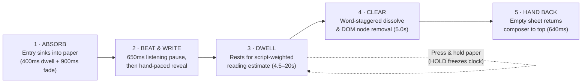

<div align="center">


# Inkling

### **A page that writes back — and lets go.**

An **ACM DIS-style critical design provocation** and **counterfunctional AI artifact** built from three deliberate refusals:<br/>
**the record disappears**, **the writing is by hand**, and **the reply arrives at a hand's pace**.

[](#three-deliberate-constraints)
[](#why-this-is-a-provocation)
[](#theoretical-lineage)
[](#what-we-kept-what-we-refused)
[](#the-forgetting-lifecycle)
[](LICENSE)

<br/>


<p><sub><i>"The diary remembers nothing. It is still listening."</i></sub></p>

[**The Provocation**](#why-this-is-a-provocation) ·
[**Three Constraints**](#three-deliberate-constraints) ·
[**Theoretical Lineage**](#theoretical-lineage) ·
[**Design Value & Implications**](#design-value--implications) ·
[**Expected Outcomes**](#expected-outcomes--hypotheses) ·
[**The Artifact**](#the-artifact) ·
[**Quick Start**](#quick-start)

[**📄 Full Research Note (`docs/RESEARCH.md`)**](docs/RESEARCH.md) ·
[**🪶 Ink Engine (`docs/INK.md`)**](docs/INK.md) ·
[**🌿 60 Drawings (`docs/GLYPHS.md`)**](docs/GLYPHS.md)

</div>

---

> [!NOTE]
> **Reading this repository:** Inkling is a **Research-through-Design (RtD)** instrument. Every recording on this page runs in the live application; clips are sped up slightly so a README stays a README. For the full theoretical framework, 2×2 study protocol, and 28-source bibliography, read [**`docs/RESEARCH.md`**](docs/RESEARCH.md).

---

## 🕯️ Why this is a provocation

In *Harry Potter and the Chamber of Secrets*, Tom Riddle's diary answers in handwriting on the very same page. It is compelling because it listens; it is dangerous because **it remembers**. Its memory is the mechanism by which intimacy becomes extraction and possession.

Contemporary conversational AI is built on that same default at industrial scale: **keep everything**. Every exchange is logged, indexed, summarized into a longitudinal user profile, and carried into future sessions (Park et al., 2023). In product language, total retention is framed as *continuity*, *personalization*, and *care*. Yet total capture carries a hidden psychological and epistemic cost: when every sentence is archived for an algorithmic profile or a future self, reflection becomes a performance of coherence (Mayer-Schönberger, 2009; Sellen & Whittaker, 2010; Bannon, 2006).

**Inkling keeps the uncanny object and removes the extractive mechanism:** the page answers in handwriting, and then it lets go.

> [!IMPORTANT]
> **Central Thesis:** *A structural guarantee of disappearance lowers the threshold for saying the thing.*
> When there is no archive to curate and no persistent profile watching over your shoulder, writing shifts from **self-archiving** to **present-tense release**.

This repository is framed as a **design provocation in the ACM DIS sense** (Designing Interactive Systems): not a commercial product proposal, but a fully realized **counterfunctional thing** (Pierce & Paulos, 2014) that makes an invisible industry default visible by building its exact opposite.

- **Research through Design (RtD)** establishes that the working artifact—its material decisions, timing curves, and edge cases—is itself the theoretical contribution (Zimmerman et al., 2007; Gaver, 2012; Boehner et al., 2007).
- **Critical & Reflective Design** supplies the stance: interfaces are arguments about human values, not neutral containers for model tokens (Dunne & Raby, 2013; Bardzell & Bardzell, 2013; Sengers et al., 2005).
- **Adversarial & Counterfunctional Design** supplies the method: contesting a dominant technological narrative by deliberately negating its core functional expectations (DiSalvo, 2012; Pierce, 2012).

Inkling is not a productivity journal, not a clinical therapist, and not a companion chatbot. It is a counter-position, a conversation opener, and an epistemic instrument.

---

## 🧭 Three deliberate constraints

Inkling is constructed from **three structural refusals**. Every interaction detail in the codebase follows from holding these three constraints together at once.

| Constraint | How it is materialized in the interface | What dominant AI default it refuses | What experiential space it opens |
|---|---|---|---|
| **1. It forgets.**<br/>*(Structural Ephemerality)* | Blank-page mode by default; volatile tab-only context; zero database, zero content logs; OpenAI Responses API explicitly sets `store: false`; DOM nodes unmount on `animationend`. | Infinite scrollback, searchable history, transcript export, cross-session user profiling. | **Present-tense candor:** freedom from performing for a future reader or an algorithmic dossier. |
| **2. It is written by hand.**<br/>*(Embodied Inscription)* | Stylus or finger pressure canvas (`perfect-freehand`); 4 paired Latin/Hangul hands; inline strokes (`__underline__`, `((circle))`, `==highlight==`) and 60 hand-drawn glyphs (`[[knot]]`). | Uniform keyboard text boxes, chat bubbles, avatars, copy-pasted walls of text. | **Somatic presence:** hesitation stays visible as stroke wobble; feeling registers as pressure and margin marks. |
| **3. It is slow.**<br/>*(Earned Slowness)* | Single-occupant sheet gate (`whenPaperClears()`); `650ms` listening beat; grapheme-by-grapheme reveal with punctuation lifts; reading-weighted dwell; no skip button. | Instant token streaming (`>50 tok/s`), loading spinners, skip/fast-forward controls. | **Interstitial reflection:** time to reread your own sentence as it sinks, and to experience waiting as *being written to*. |

### 1 · It forgets (Removing the Future Audience)

Nothing written on this page is persisted on the server. When you hand an entry over, it sinks into the paper before Riddle writes a single word; once Riddle's reply has stayed long enough to be read, it dissolves word by word from both the screen and the DOM. Reload the tab or close the window and the slate is clean. Upstream requests pass `store: false` so the model provider does not retain the exchange as retrievable application state. **Forgetting is not a missing feature here; it is the primary affordance.**

### 2 · It is written by hand (Restoring the Body)

Typing flattens every mood into identical keystrokes. Handwriting is slower, clumsier, and more revealing: hesitation leaves a tremor in the stroke, and emphasis leaves weight on the line (Dourish, 2001). When you write by hand, Inkling sends the rasterized sheet to `gpt-5.4-mini` vision and strips the hidden `READ:` transcription from the display stream—so **only your raw ink ever sits on the paper**. Typing remains available as an accessibility and hardware accommodation, never as the conceptual default.

### 3 · It is slow (One Hand on the Sheet at a Time)

In a standard chat window, two voices crowd a scrolling feed. In Inkling, **the paper belongs to one hand at a time**. Your ink must completely absorb into the sheet (`1.3s`) before the turn gate opens. A **650ms listening beat** rests on the empty paper before Riddle's first stroke appears. Every character is revealed at a hand's cadence with proportional rests at commas and full stops, and the input surface returns only after the last word of the reply has faded. There is no skip button: **the waiting is the interface**.

---

## 🔄 The forgetting lifecycle

Instead of a scrolling chat log, each exchange in Blank-Page Mode moves through five named phases—a transferable **Strong Concept** (Höök & Löwgren, 2012) for ephemeral human–AI interaction:



<div align="center">


<p><sub><i>Hand it over · it sinks (Absorb) · Riddle pauses & writes · you read (Dwell / Hold) · it clears (Clear) · your turn again (Hand back).</i></sub></p>

</div>

---

## 🧱 What we kept, what we refused

Most conversational AI products accumulate memory, streaks, notifications, and persona warmth because those features drive retention metrics. Inkling uses **undesigning** (Pierce, 2012)—removing the engagement apparatus to ask what remains when an AI only listens in the present tense.

| What we kept (The Counter-Proposal) | What we refused (The Industry Default) |
|---|---|
| **The hand:** ink pressure, stroke wobble, 4 Latin/Hangul hands, 60 margin drawings | Frictionless convenience as the unexamined goal of interaction |
| **The wait:** a `650ms` listening beat, punctuation pen-lifts, reading-weighted dwell | Instant token dumping, loading spinners, "Skip animation" buttons |
| **Structural forgetting:** the sheet clears, the DOM unmounts, the tab dies (`store: false`) | Scrollable history, transcript export, search, cross-session profiling |
| **Poetic restraint:** copying one exact fragment, asking at most one question, or drawing a glyph | Unsolicited advice, clinical diagnosis, coaching personas, false cheer |
| **Single-hand spatiality:** one occupant on the paper at a time (`whenPaperClears()`) | Two voices competing inside a vertically scrolling messaging feed |
| **Accessible transience:** persistent `aria-live` layer, `hold-to-keep`, visibility-paused clocks | Treating ephemerality as an excuse to exclude slow or disabled readers |

---

## 🔬 Theoretical lineage

Slow technology is the starting point, not the whole story. Inkling synthesizes **eight streams of HCI and design research** to ground its provocation:

| Research Stream | Key Citations | What It Explains in Inkling |
|---|---|---|
| **Slow Technology & Slow Design** | Hallnäs & Redström (2001); Grosse-Hering et al. (2013); Odom et al. (2014) | Designing for reflection and anticipation rather than time-compression. Waiting is an active material, not network latency. |
| **Counterfunctional Things & Undesigning** | Pierce & Paulos (2014); Pierce (2012) | Deliberately inhibiting canonical digital functions (save, search, export, fast-forward) to unlock new experiential qualities. |
| **Forgetting & Critique of Total Capture** | Bannon (2006); Mayer-Schönberger (2009); Sellen & Whittaker (2010) | Why permanent archives induce self-censorship and why structural forgetting is a vital human affordance, not a system failure. |
| **Ephemeral UI & Rituals of Release** | Döring et al. (2013); Sas & Whittaker (2013) | Using visual decay as an interface material and designing material rituals (ink sinking into paper) for emotional letting go. |
| **Critical, Reflective & Adversarial Design** | Dunne & Raby (2013); Bardzell & Bardzell (2013); Sengers et al. (2005); DiSalvo (2012) | Contesting the dominant *Memory-First AI* paradigm (Park et al., 2023) by building a working counter-system that exposes hidden ideological costs. |
| **Embodied Interaction, Ambiguity & Seams** | Dourish (2001); Gaver et al. (2003); Chalmers & Galani (2004) | Why physical strokes matter; why Riddle uses **interpretive ambiguity** (one fragment, ≤1 question, or an unannotated glyph `[[knot]]`); and why system seams are disclosed honestly. |
| **Design Frictions & Microboundaries** | Cox et al. (2016) | How small intentional pauses—the 4s hand-over ring, **Not yet**, and the single-hand gate—create mindful transitions between writing and reading. |
| **Social Actors, ELIZA & Expressive Writing** | Weizenbaum (1966); Pennebaker & Beall (1986); Nass & Moon (2000); Bickmore & Picard (2005) | Why humans read a replying page as *someone*, and how to support expressive disclosure while refusing parasocial manipulation. |
| **Research through Design & Strong Concepts** | Zimmerman et al. (2007); Boehner et al. (2007); Gaver (2012); Höök & Löwgren (2012) | How a single provocative artifact generates transferable **intermediate-level design knowledge** (*absorb, dwell, clear, hold, hand back*). |

<details>
<summary><strong>📚 Full Bibliography — 28 Sources (ACM Reference Format)</strong></summary>

<br/>

1. Liam J. Bannon. 2006. Forgetting as a Feature, Not a Bug: The Duality of Memory and Implications for Ubiquitous Computing. *CoDesign* 2, 1 (2006), 3–15. https://doi.org/10.1080/15710880600608230
2. Jeffrey Bardzell and Shaowen Bardzell. 2013. What is "critical" about critical design? In *Proceedings of the SIGCHI Conference on Human Factors in Computing Systems* (CHI '13). ACM, New York, NY, USA, 3297–3306. https://doi.org/10.1145/2470654.2466451
3. Timothy W. Bickmore and Rosalind W. Picard. 2005. Establishing and Maintaining Long-Term Human-Computer Relationships. *ACM Transactions on Computer-Human Interaction* 12, 2 (2005), 293–327. https://doi.org/10.1145/1067860.1067867
4. Kirsten Boehner, Janet Vertesi, Phoebe Sengers, and Paul Dourish. 2007. How HCI Interprets the Probes. In *Proceedings of the SIGCHI Conference on Human Factors in Computing Systems* (CHI '07). ACM, New York, NY, USA, 1077–1086. https://doi.org/10.1145/1240624.1240789
5. Virginia Braun and Victoria Clarke. 2006. Using Thematic Analysis in Psychology. *Qualitative Research in Psychology* 3, 2 (2006), 77–101. https://doi.org/10.1191/1478088706qp063oa
6. Matthew Chalmers and Areti Galani. 2004. Seamful Interweaving: Heterogeneity in the Theory and Design of Interactive Systems. In *Proceedings of the 5th Conference on Designing Interactive Systems: Processes, Practices, Methods, and Techniques* (DIS '04). ACM, New York, NY, USA, 243–252. https://doi.org/10.1145/1013115.1013149
7. Anna L. Cox, Sandy J. J. Gould, Marta E. Cecchinato, Ioanna Iacovides, and Ian Renfree. 2016. Design Frictions for Mindful Interactions: The Case for Microboundaries. In *Proceedings of the 2016 CHI Conference Extended Abstracts on Human Factors in Computing Systems* (CHI EA '16). ACM, New York, NY, USA, 1389–1397. https://doi.org/10.1145/2851581.2892410
8. Carl DiSalvo. 2012. *Adversarial Design*. MIT Press, Cambridge, MA.
9. Tanja Döring, Axel Sylvester, and Albrecht Schmidt. 2013. A Design Space for Ephemeral User Interfaces. In *Proceedings of the 7th International Conference on Tangible, Embedded and Embodied Interaction* (TEI '13). ACM, New York, NY, USA, 75–82. https://doi.org/10.1145/2460625.2460637
10. Paul Dourish. 2001. *Where the Action Is: The Foundations of Embodied Interaction*. MIT Press, Cambridge, MA.
11. Anthony Dunne and Fiona Raby. 2013. *Speculative Everything: Design, Fiction, and Social Dreaming*. MIT Press, Cambridge, MA.
12. William Gaver. 2012. What Should We Expect from Research through Design? In *Proceedings of the SIGCHI Conference on Human Factors in Computing Systems* (CHI '12). ACM, New York, NY, USA, 937–946. https://doi.org/10.1145/2207676.2208538
13. William W. Gaver, Jacob Beaver, and Steve Benford. 2003. Ambiguity as a Resource for Design. In *Proceedings of the SIGCHI Conference on Human Factors in Computing Systems* (CHI '03). ACM, New York, NY, USA, 233–240. https://doi.org/10.1145/642611.642653
14. Barbara Grosse-Hering, Jon Mason, Dzmitry Aliakseyeu, Conny Bakker, and Pieter Desmet. 2013. Slow Design for Meaningful Interactions. In *Proceedings of the SIGCHI Conference on Human Factors in Computing Systems* (CHI '13). ACM, New York, NY, USA, 3431–3440. https://doi.org/10.1145/2470654.2466472
15. Lars Hallnäs and Johan Redström. 2001. Slow Technology – Designing for Reflection. *Personal and Ubiquitous Computing* 5, 3 (2001), 201–212. https://doi.org/10.1007/PL00000019
16. Kristina Höök and Jonas Löwgren. 2012. Strong Concepts: Intermediate-Level Knowledge in Interaction Design Research. *ACM Transactions on Computer-Human Interaction* 19, 3, Article 23 (Oct. 2012), 18 pages. https://doi.org/10.1145/2362364.2362371
17. Viktor Mayer-Schönberger. 2009. *Delete: The Virtue of Forgetting in the Digital Age*. Princeton University Press, Princeton, NJ.
18. Clifford Nass and Youngme Moon. 2000. Machines and Mindlessness: Social Responses to Computers. *Journal of Social Issues* 56, 1 (2000), 81–103. https://doi.org/10.1111/0022-4537.00153
19. William Odom, Abigail Sellen, Richard Banks, David Kirk, Tim Regan, Mark Selby, Jodi Forlizzi, and Jonathan Zimmerman. 2014. Designing for Slowness, Anticipation and Re-visitation: A Long Term Field Study of the Photobox. In *Proceedings of the SIGCHI Conference on Human Factors in Computing Systems* (CHI '14). ACM, New York, NY, USA, 1961–1970. https://doi.org/10.1145/2556288.2557178
20. Joon Sung Park, Joseph C. O'Brien, Carrie J. Cai, Meredith Ringel Morris, Percy Liang, and Michael S. Bernstein. 2023. Generative Agents: Interactive Simulacra of Human Behavior. In *Proceedings of the 36th Annual ACM Symposium on User Interface Software and Technology* (UIST '23). ACM, New York, NY, USA, Article 2, 1–22. https://doi.org/10.1145/3586183.3606763
21. James W. Pennebaker and Sandra K. Beall. 1986. Confronting a Traumatic Event: Toward an Understanding of Inhibition and Disease. *Journal of Abnormal Psychology* 95, 3 (1986), 274–281. https://doi.org/10.1037/0021-843X.95.3.274
22. James Pierce. 2012. Undesigning Technology: Considering the Negation of Design by Design. In *Proceedings of the SIGCHI Conference on Human Factors in Computing Systems* (CHI '12). ACM, New York, NY, USA, 957–966. https://doi.org/10.1145/2207676.2208540
23. James Pierce and Eric Paulos. 2014. Counterfunctional Things: Exploring Possibilities in Designing Digital Limitations. In *Proceedings of the 2014 Conference on Designing Interactive Systems* (DIS '14). ACM, New York, NY, USA, 375–384. https://doi.org/10.1145/2598510.2598522
24. Corina Sas and Steve Whittaker. 2013. Design for Forgetting: Disposing of Digital Possessions after a Breakup. In *Proceedings of the SIGCHI Conference on Human Factors in Computing Systems* (CHI '13). ACM, New York, NY, USA, 1823–1832. https://doi.org/10.1145/2470654.2466241
25. Abigail J. Sellen and Steve Whittaker. 2010. Beyond Total Capture: A Constructive Critique of Lifelogging. *Communications of the ACM* 53, 5 (2010), 70–77. https://doi.org/10.1145/1735223.1735243
26. Phoebe Sengers, Kirsten Boehner, Shay David, and Joseph 'Jofish' Kaye. 2005. Reflective Design. In *Proceedings of the 4th Decennial Conference on Critical Computing: Between Sense and Sensibility* (CC '05). ACM, New York, NY, USA, 49–58. https://doi.org/10.1145/1094562.1094569
27. Joseph Weizenbaum. 1966. ELIZA—A Computer Program for the Study of Natural Language Communication between Man and Machine. *Communications of the ACM* 9, 1 (1966), 36–45. https://doi.org/10.1145/365153.365168
28. John Zimmerman, Jodi Forlizzi, and Shelley Evenson. 2007. Research through Design as a Method for Interaction Design Research in HCI. In *Proceedings of the SIGCHI Conference on Human Factors in Computing Systems* (CHI '07). ACM, New York, NY, USA, 493–502. https://doi.org/10.1145/1240624.1240704

</details>

---

## 💡 Design value & implications

Inkling does not argue that every AI system should forget. It argues that **memory in conversational AI is a design choice with moral and psychological costs, not an invisible default**.

Following Höök and Löwgren's (2012) framework of **intermediate-level knowledge**, the artifact yields six design implications that travel beyond this project (expanded in [**`docs/RESEARCH.md` §4**](docs/RESEARCH.md#4-design-value--transferable-implications)):

### 1 · Memory is an ideological choice, not neutral infrastructure
Storing a transcript introduces a future observer into the present moment and creates an incentive to profile the user. Designers of reflective or wellbeing systems should conduct a **Memory Audit**—asking not only *"How do we secure this data?"* but *"What does the existence of this archive prevent the user from saying?"*—and audit upstream provider defaults (`store: false`).

### 2 · Slowness must be earned through brevity and rhythm
Adding a delay to a chatbot creates latency, not slow technology. Waiting reads as *attentive writing* only when three conditions hold together: the user's own entry has just sunk into the paper, the reply arrives with human micro-rhythms (script-weighted strokes, ±18% jitter, punctuation pen-lifts), and the reply is strictly brief (1–3 sentences).

### 3 · Spatial turn-taking ("One Hand at a Time") replaces the scrolling feed
The infinite chat feed frames conversation as an accumulating ledger. Enforcing that **the sheet belongs to one hand at a time**—so your ink clears before Riddle writes, and Riddle's ink clears before your composer returns to the exact same spot—shifts interaction from *managing a thread* to *inhabiting a turn*.

### 4 · Handwriting is an epistemic mode, not a typographic skin
A cursive font over a chat bubble is a costume. Treating the hand as a true modality means preserving raw somatic strokes on the canvas (never replacing the user's handwriting on screen with OCR text), supporting spatial marks (`__underline__`, `((circle))`, `==highlight==`), and accepting the vulnerability of illegibility.

### 5 · Productive ambiguity resists parasocial and clinical overreach
Rather than simulating an empathetic therapist, Inkling applies Gaver et al.'s (2003) **ambiguity as a resource**: Riddle copies out one fragment of your words, asks at most one open question, or draws one of sixty unannotated shapes (`[[rain]]`, `[[knot]]`, `[[candle]]`). Doing less prevents false diagnostic authority while preserving the relief of being heard.

### 6 · Ephemerality and accessibility are a paired pattern, not opposites
Disappearing text is exclusionary if designed naively. Inkling proves that visual decay and perceptual access can coexist by pairing CSS-composited fading with a persistent `aria-live="polite"` transcript, pointer/keyboard **hold-to-keep** (`--fade-state: paused`), visibility-aware clocks that pause when the tab is hidden or the user is mid-sentence, and `prefers-reduced-motion` support.

### The tensions left open on purpose

| Design Refusal | Value Gained | Cost Surrendered | Unresolved Tension |
|---|---|---|---|
| **No archive or export** | Unguarded candor, present-tense release | Longitudinal continuity, revisiting past insights | *Candor vs. Continuity* |
| **Handwriting first** | Embodied presence, visible hesitation | Speed, effortless keyboard ergonomics | *Embodiment vs. Convenience* |
| **Hand-paced reveal** | Interstitial rereading, felt listening | Immediate throughput, skimmability | *Reflection vs. Efficiency* |
| **Single-hand sheet gate** | Contemplative ritual, undivided attention | Ability to interrupt or rapid-fire message | *Ritual vs. Autonomy* |
| **Anti-persona restraint** | Epistemic honesty, non-manipulation | Comforting illusion of a human companion | *Honesty vs. Attachment* |

---

## 🧪 Expected outcomes & hypotheses

Because Inkling is an empirical probe as well as a critical artifact, its expected outcomes are specified across **behavioral shifts**, **interpretive readings**, and **falsifiable study hypotheses** (full protocol in [**`docs/RESEARCH.md` §5–§6**](docs/RESEARCH.md#5-expected-outcomes--phenomenological-predictions)).

### What we expect to happen in the exchange

- **The Candor Shift:** Without a future reader or persistent profile, entries shift from curated daily summaries to unguarded, fragmented, first-person admissions.
- **Interstitial Self-Witnessing:** During the `1.3s` absorption window and `650ms` listening beat, writers naturally reread the sentence they just released before Riddle's pen touches the page.
- **Tactile Time Negotiation:** Rather than asking for a skip button, readers use **Not yet** (canceling the 4s auto-hand-over ring) and **hold-to-keep** (pressing the paper to freeze decay) to hold time in their hands.
- **Relational Reframing:** In interviews, the system is described not as *"generating"* or *"loading"*, but as *"listening"*, *"taking its turn"*, and *"letting go"*.

### What counts as success — and what would falsify the claim

| Dimension | Success Signal (Validates the Provocation) | Failure Signal (Refutes or Complicates It) |
|---|---|---|
| **Disclosure (`H1`)** | `Blank` mode yields longer, more specific first-person entries than `Keep` mode; *"I wouldn't have written that if it stayed."* | Entries shrink in `Blank` mode; users screenshot or copy-paste out of anxiety before the ink fades. |
| **Tempo (`H2`)** | `≥60%` describe the wait as *"someone writing"* rather than *"system loading"*; no demand for a skip button. | Waiting is experienced as lag or a slow loading spinner; users abandon turns mid-reveal. |
| **Embodiment (`H3`)** | Handwriting stays chosen on free-choice days; margin marks (`((circle))`) and solo glyphs (`[[candle]]`) are remembered. | Users permanently switch to typing after Day 1; handwriting feels like gratuitous physical friction. |
| **Ritual (`H4`)** | Single-hand turn gate and `hold-to-keep` are experienced as calm etiquette and agency. | Users repeatedly tap the locked sheet trying to interrupt; the turn gate reads as a UI bug. |
| **Absence (`H5`)** | Returning to a blank, memoryless page feels clean, unjudged, and lighter than memory-heavy chatbots. | Users disengage because *"it doesn't know me anymore"*, proving that reflection requires selective continuity. |
| **Disciplinary Impact** | Designers adopt the **Memory Audit** and the 5-part forgetting vocabulary (*absorb, dwell, clear, hold, hand back*). | The project is read merely as a nostalgic *Harry Potter* theme over a standard chat wrapper. |

> [!TIP]
> **Built-In Experimental Apparatus:** The live app already contains the four conditions needed for a **2×2 within-subject diary study** (`Hand vs. Type` × `Blank vs. Keep`). See [**`docs/RESEARCH.md` §6**](docs/RESEARCH.md#6-empirical-protocol-a-within-subject-study-design) for the 12-participant, 14-day Latin-square protocol designed with **zero server content logging**.

---

## ✨ The artifact

A single-page web application, a single stateless streaming endpoint, and a custom dual-backend ink engine.

| Feature | Craft & Implementation Detail |
|---|---|
| 📖 **Blank-page mode** | What you hand over sinks in at once (`400ms` + `900ms`); the reply rests for a script-weighted reading estimate (`4.5s–20s`) and clears before the composer returns. |
| ✍️ **Handwriting first** | Stylus, finger, or keyboard; four paired Latin + Hangul handwriting faces (`Caveat/Gaegu`, `Shadows Into Light/Nanum Pen`, `Kalam/Nanum Brush`, `Patrick Hand/Hi Melody`). |
| 🪶 **Two backends, one clock** | Per-grapheme animated `clip-path` for Korean and English text + SVG `stroke-dashoffset` for marks and drawings, scheduled on a single deterministic `InkClock`. |
| 🌿 **Riddle draws 60 glyphs** | Inline sketches (`[[rain]]`, `[[knot]]`, `[[sprout]]`, `[[hourglass]]`) drawn stroke by stroke in the same hand — sometimes a solo drawing at `2.9em` *is* the entire reply. See [**`docs/GLYPHS.md`**](docs/GLYPHS.md). |
| ⏱️ **Time you can hold** | A 4-second hand-over ring on pen lift, a **Not yet** escape, press-and-hold paper to freeze decay, and clocks that pause while you write or hide the tab. |
| 🔒 **Zero persistence** | No database, no content logs, volatile tab memory, and `store: false` on every upstream OpenAI Responses API call. |

---

## 🛠️ What the making taught us

Building a counterfunctional artifact exposes assumptions that theory alone misses (documented in [**`docs/INK.md`**](docs/INK.md) and [**`docs/RESEARCH.md` §7**](docs/RESEARCH.md#7-evidence-from-the-build-rtd-reflections)):

- **Formal invariants are not visual resemblance.** All sixty drawings passed unit tests for bounding boxes and valid path data, yet rendering a contact sheet ([`docs/media/glyphs.png`](docs/media/glyphs.png)) revealed five that were the wrong picture—a cloud that looked like mountains, a moon that was a lens, a drop that was a gem, a bridge that was a hammock, and wind that was chatter. The fix was looking.
- **A turn gate must read the store, never a render snapshot.** The single-hand gate initially read a React snapshot; on the second turn it described the sheet before the new entry landed ("empty") and let Riddle write on top of sinking ink.
- **Disappearing interfaces need stricter internal ordering.** A vision `READ:` transcription could arrive over the network *after* the handwritten turn had already faded from the DOM. The store now tracks turns by immutable ID so context survives visual decay.
- **The smallest mark decides the metaphor.** An early leading nib dot at the reveal edge read unmistakably as a blinking text cursor. Removing it so *nothing precedes the ink* made the page feel like paper.
- **A privacy promise includes provider defaults.** The OpenAI Responses API retains state for 30 days by default. Passing `store: false` is an interaction design decision, not merely backend configuration.

---

## 🚫 What we deliberately did not build

### Cross-session memory
The obvious next feature is the one the film warns about: you log in, Riddle remembers you across days, and the conversation accumulates. **It is deliberately not built.**

If cross-session continuity is ever explored in the future, four guardrails in [`CLAUDE.md`](CLAUDE.md) are non-negotiable:
1. A memory must be written *about* an exchange (a one-line impression), never *from* it. Storing transcripts and calling it memory is the failure mode.
2. Strictly opt-in per account, visible, editable, and deletable in a single action.
3. The paper still clears. Nothing kept ever returns to the sheet as a readable log.
4. The non-persistence rule is rewritten publicly before a single row is stored.

### Permanent anti-features
- **No** history drawer, export button, search bar, or transcript download.
- **No** daily streaks, push reminders, badges, or retention loops.
- **No** therapeutic advice, clinical diagnosis, or coaching persona.
- **No** avatar, chat bubbles, timestamps, or typing indicators.
- **No** skip button, and **no** analytics on what people write.

---

## 🗺️ Roadmap

- [x] **Riddle draws** — sixty hand-sketched glyphs through the same `stroke-dashoffset` engine that draws the circles
- [x] **The page knows the hour** — an opening line that follows the reader's local time of day
- [x] **A listening beat** — a `650ms` stillness and breathing ink drop before the first stroke of every reply
- [x] **A date in the margin** — quiet page furniture written in the sheet's own hand
- [ ] **Context-sized drawings** — shapes and connectors sized dynamically to the phrase they sit beside
- [ ] **Single-stroke Latin backend** — true centerline stroke synthesis for Latin scripts alongside Hangul `clip-path`
- [ ] **Tactile paper & sound** — optional page turns, subtle grain variations, and quiet nib acoustics
- [ ] **End-of-session ritual** — *keep one sentence you choose, burn the rest* (exploring selective ritual preservation; see [`docs/RESEARCH.md` §5.5](docs/RESEARCH.md#55-rival-explanations-negative-results-and-productive-surprises))
- **Cross-session transcript memory — permanently out of scope.**

---

## 🚀 Quick start

```bash
git clone https://github.com/Soohwan-Lee/riddle-diary-web.git
cd riddle-diary-web
npm install
cp .env.example .env.local     # optional — runs in mock mode without a key
npm run dev
```

Open **<http://localhost:3000>**.

> [!TIP]
> **No API key? It still runs.** Without `OPENAI_API_KEY`, `/api/converse` streams curated replies at a realistic cadence—including underlines, circles, highlights, and drawings—so the entire interaction ritual can be inspected and tested at zero cost.

### Environment variables

| Variable | Required | Description |
|---|---|---|
| `OPENAI_API_KEY` | No | Server-only API key. When omitted, the app runs in deterministic mock streaming mode. |
| `OPENAI_MODEL` | No | Defaults to `gpt-5.4-mini` (must support vision input and the OpenAI Responses API). |
| `MOCK_AI` | No | Set to `1` to force mock streaming even when `OPENAI_API_KEY` is present. |
| `NEXT_PUBLIC_SITE_URL` | No | Public origin used for canonical URLs, sitemap generation, and OpenGraph cards. |

### Deploy

[](https://vercel.com/new/clone?repository-url=https%3A%2F%2Fgithub.com%2FSoohwan-Lee%2Friddle-diary-web&env=OPENAI_API_KEY&envDescription=Optional%20—%20leave%20blank%20to%20run%20in%20mock%20mode)

Zero configuration required. The single `/api/converse` endpoint runs on the Node.js runtime with SSE streaming (time-to-first-character is hidden inside the `1.3s` paper absorption window). For public deployments, **always configure an account-level OpenAI spend limit** alongside the built-in per-instance token-bucket rate limiter.

### Scripts

```bash
npm run dev        # Start Next.js development server
npm run check      # Run TypeScript typecheck + ESLint + 207 Vitest unit tests
npm run build      # Build production bundle
npm run test       # Run Vitest unit test suite
```

---

## 📚 Documentation & architecture

| Document | Scope |
|---|---|
| [**`docs/RESEARCH.md`**](docs/RESEARCH.md) | **Research note & DIS provocation:** theoretical framework, related work matrix, design implications, expected outcomes, 2×2 study protocol, limitations, and 28 ACM references. |
| [**`docs/INK.md`**](docs/INK.md) | **Technical craft:** dual ink backends (`clip-path` + `stroke-dashoffset`), script-weighted timing, incremental `InkScript` parser, fading compositor, and the four hands. |
| [**`docs/GLYPHS.md`**](docs/GLYPHS.md) | **Drawing vocabulary:** all sixty hand-drawn glyphs, the visual contact sheet, and invariants for adding new drawings. |
| [**`docs/PLAN.md`**](docs/PLAN.md) | **Iterative design log (KO):** original specification and version-by-version record (`v1.0` → `v1.3`) of how the build diverged from the plan. |

Built with **Next.js 16**, **React 19**, **TypeScript**, **Tailwind CSS 4**, **zustand**, **perfect-freehand**, and the **OpenAI Responses API** (`store: false`).

---

## 📄 License & citation

Released under the [MIT License](LICENSE).

```bibtex
@misc{lee2026inkling,
  author       = {Lee, Soohwan},
  title        = {Inkling: A Diary That Writes Back and Lets Go — A Critical Design Provocation on Ephemeral Conversational AI},
  year         = {2026},
  howpublished = {\url{https://github.com/Soohwan-Lee/riddle-diary-web}},
  note         = {Research-through-Design artifact and counterfunctional web system}
}
```

<div align="center">
<br/>
<sub><i>Inspired, at a distance, by a diary in a film that wrote back. That one was a manipulator; this one holds still.</i></sub>
<br/><br/>
<a href="#inkling"><b>↑ Back to top</b></a>
</div>
