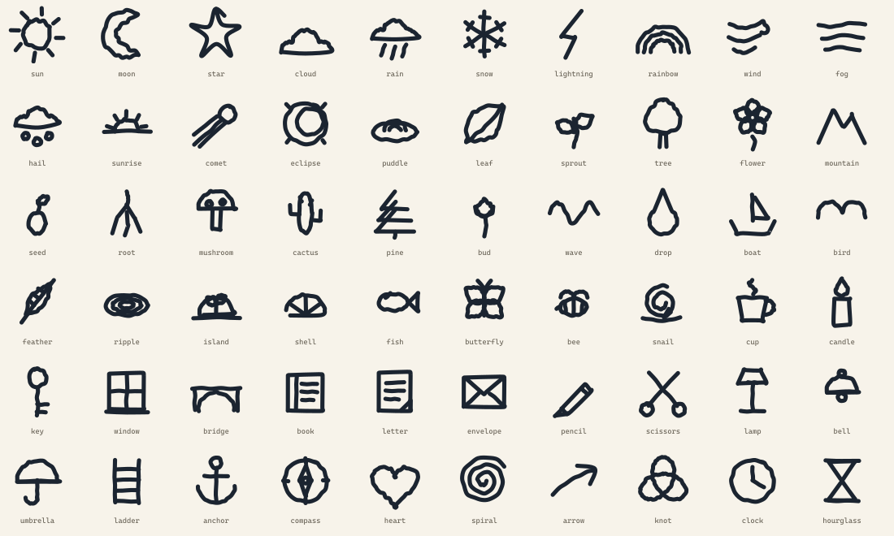

# Inkling — the drawing vocabulary

[← Back to the README](../README.md)

Sixty things Riddle can draw, all through the same `stroke-dashoffset` engine that
draws the circles. Each one takes one character's room in the line, and now and then
a drawing alone is the whole reply.

[Vector source](media/glyphs.svg)

## Why a fixed vocabulary

A model that invents SVG paths is a reliability problem and a safety problem. The
paths come out broken or ugly, and there is no way to know which until the ink is
already on the paper. A name looked up in a table cannot carry markup into the
renderer.

So the vocabulary is fixed. The model can ask for `[[rain]]` or `[[knot]]`; it cannot
ask for a shape that does not exist.

## The set

**Sky and weather**
sun, moon, star, cloud, rain, snow, lightning, rainbow, wind, fog, hail, sunrise,
comet, eclipse, puddle

**Growing things**
leaf, sprout, tree, flower, mountain, seed, root, mushroom, cactus, pine, bud

**Water and air**
wave, drop, boat, bird, feather, ripple, island, shell, fish, butterfly, bee, snail

**Small things**
cup, candle, key, window, bridge, book, letter, envelope, pencil, scissors, lamp,
bell, umbrella, ladder, anchor, compass

**Shapes that mean something**
heart, spiral, arrow, knot, clock, hourglass

## Adding a glyph

1. Add the name to `GLYPHS` in [`src/lib/ink/glyph.ts`](../src/lib/ink/glyph.ts) and
   write a builder that returns strokes in the order a hand would make them.
2. Add a label to `dictionaries.glyphs` for **ko** and **en**.
3. Add `[[name]]` to the DRAWINGS list in [`src/lib/ai/prompt.ts`](../src/lib/ai/prompt.ts).
4. Run `npm run check`. The vocabulary test fails if a label or prompt token is
   missing.
5. Render the contact sheet and look at it. A shape can pass "is inside its box, is
   real path data" and still be the wrong picture.

The contact sheet is the important step. Five of the first thirty drawings were
wrong in ways no test could see: a cloud that was a mountain range, a crescent that
was a lens, a teardrop that was a gem, a bridge that was a hammock, and wind that was
pure chatter. The fix for all of them was looking.

---

[← Back to the README](../README.md)
