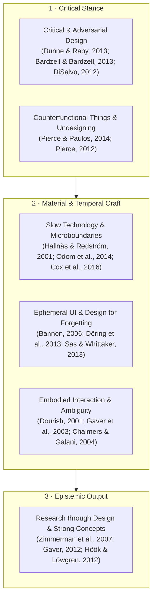
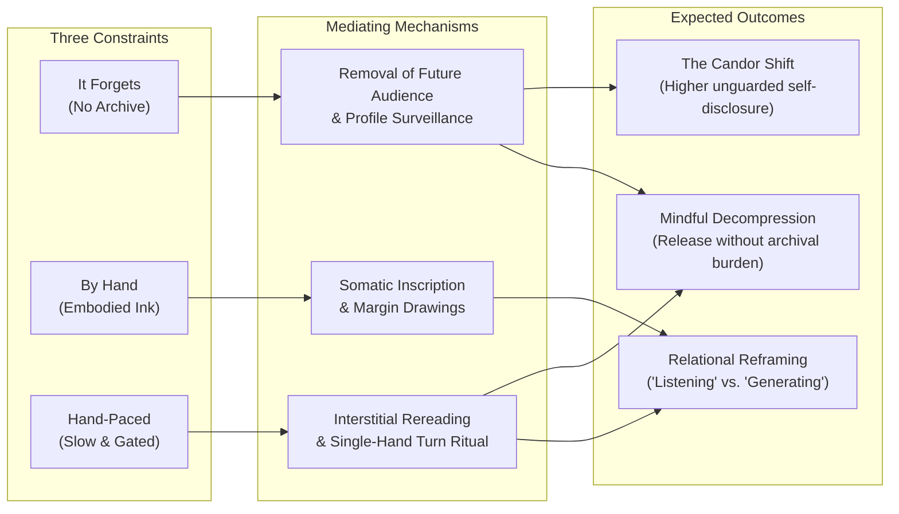

# Inkling — Research Notes & Design Provocation

[← Back to the README](../README.md) · [Technical Notes (INK.md)](INK.md) · [Drawing Vocabulary (GLYPHS.md)](GLYPHS.md)

> **A Research-through-Design (RtD) provocation and counterfunctional artifact.**
> This document articulates the theoretical lineage, design value, transferable
> implications, expected phenomenological outcomes, and empirical study protocol
> for **Inkling** — a conversational diary that answers in handwriting at a hand's
> pace and keeps nothing.

| Dimension | Specification |
|---|---|
| **Artifact** | A single-sheet web diary that replies in handwriting, draws in the margin, and clears from both screen and DOM |
| **Genre** | ACM DIS Provocation · Critical & Counterfunctional Design · Slow Technology Probe |
| **Core Thesis** | *A structural guarantee of disappearance lowers the threshold for candid self-disclosure* |
| **Design Position** | Memory in conversational AI is a moral and interaction choice with hidden costs, not a neutral default |
| **Three Refusals** | **It forgets** (no archive) · **It is written by hand** (no uniform chat input) · **It is slow** (no instant generation) |
| **Knowledge Contribution** | Six design implications for reflective AI + a five-part interaction vocabulary (*absorb, dwell, clear, hold, hand back*) |
| **Empirical Status** | Deployed working system (207 unit tests, axe WCAG AA verified, autoethnographic log); 2×2 field study protocol specified (§6) |

**Contents**
1. [The Provocation: Against the Archive Default](#1-the-provocation-against-the-archive-default)
2. [Theoretical Framework & Intellectual Lineage](#2-theoretical-framework--intellectual-lineage)
3. [The Artifact as an Epistemic Instrument](#3-the-artifact-as-an-epistemic-instrument)
4. [Design Value & Transferable Implications](#4-design-value--transferable-implications)
5. [Expected Outcomes & Phenomenological Predictions](#5-expected-outcomes--phenomenological-predictions)
6. [Empirical Protocol: A Within-Subject Study Design](#6-empirical-protocol-a-within-subject-study-design)
7. [Evidence from the Build: RtD Reflections](#7-evidence-from-the-build-rtd-reflections)
8. [Limitations & Ethical Guardrails](#8-limitations--ethical-guardrails)
9. [References (ACM Style — 28 Sources)](#9-references-acm-style)

---

## 1. The Provocation: Against the Archive Default

Contemporary conversational AI is built on an unquestioned triad: **total retention**,
**frictionless velocity**, and **simulated intimacy**. By default, every exchange is
stored in a database, indexed for search, distilled into a longitudinal user profile,
and carried forward into future sessions (Park et al., 2023). In product discourse,
this accumulation is framed as *continuity*, *personalization*, and *care*. Yet total
capture also serves an extractive logic: once a system maintains a persistent model of
the person speaking to it, the platform acquires both the means and the incentive to
optimize for retention, habit formation, and parasocial attachment (Bickmore & Picard,
2005; Mayer-Schönberger, 2009).

In *Harry Potter and the Chamber of Secrets*, Tom Riddle's diary makes this mechanism
visceral. The diary is compelling because it answers in handwriting on the very same
paper; it is dangerous because *it remembers*. Its intimacy is the instrument through
which it extracts agency from the writer. **Inkling borrows the uncanny object and
excises the extractive mechanism:** the page listens, writes back by hand, and lets go.

> [!IMPORTANT]
> **Central Provocation:** What happens to human–AI reflection when a system answers in
> handwriting, moves at a hand's pace, and structurally refuses to remember?

When every utterance is preserved in a scrollable transcript or fed into a persistent
memory stream, the writer is never alone with the present moment. They are writing for
two silent observers: **an algorithmic profile** that categorizes them, and **a future
self** who may reread and judge the entry later (Sellen & Whittaker, 2010; Bannon,
2006). A diary written to be kept becomes a performance of coherence. A diary that
vanishes removes the future audience, shifting the act of writing from *archival
self-curation* to *present-tense release*.

Five research questions structure this inquiry—three isolating the material
constraints, one examining the turn-taking ritual they form together, and one probing
the psychological weight of absence:

- **RQ1 — Forgetting (Structural Ephemerality):** Does a credible guarantee of
  disappearance change the length, specificity, and emotional candor of what someone is
  willing to write?
- **RQ2 — Embodiment (The Hand):** Does composing by hand—and receiving replies with
  hand-drawn marks and marginalia—alter the felt presence and vulnerability of the
  exchange compared to uniform keyboard input?
- **RQ3 — Tempo (Earned Slowness):** When a reply arrives character by character after a
  deliberate pause, is the wait experienced as *attentive writing* or as *system
  latency*?
- **RQ4 — Ritual (Single-Hand Spatiality):** Does enforcing "one hand on the sheet at a
  time" produce a contemplative turn-taking ritual, or merely operational friction?
- **RQ5 — Absence (Non-Accumulation):** Across repeated encounters, does returning to a
  page with no cross-session memory feel liberating (unburdened) or hollow (unheard)?

> [!NOTE]
> **Scope of the Claim:** This is a **design research claim, not a clinical one**.
> Inkling does not assert that forgetting is universally therapeutic, that handwriting
> is superior to typing, or that slowness is inherently virtuous. It argues that
> *persistence, modality, and tempo are designable ideological conditions*, and that
> inverting the industry defaults opens an overlooked space for candid reflection.

---

## 2. Theoretical Framework & Intellectual Lineage

Inkling is situated at the intersection of **Critical Design**, **Slow Technology**, and
**Counterfunctional Interaction Design**. Rather than treating these traditions as
decorative labels, the artifact operationalizes specific theoretical commitments from
seven streams of HCI scholarship.



### 2.1 Critical, Reflective, and Adversarial Design
Critical design uses speculative and functional artifacts to expose hidden norms, values,
and power asymmetries embedded in everyday technology (Dunne & Raby, 2013; Bardzell &
Bardzell, 2013). Sengers et al. (2005) argue for *reflective design*, where interfaces
surface their own limitations so users can critically negotiate their relationship with
the system. DiSalvo (2012) extends this into *adversarial design*, where an artifact
contests a hegemonic technological narrative by materializing an agonistic alternative.
In Inkling, the contested narrative is **memory-first AI** (exemplified by generative
agent architectures that log, synthesize, and retrieve every observation; Park et al.,
2023). Inkling does not critique AI memory through a policy essay; it builds a working
conversational page where memory is structurally absent.

### 2.2 Counterfunctional Things and Undesigning
At ACM DIS, Pierce and Paulos (2014) introduced **counterfunctional things**: artifacts
that deliberately inhibit, invert, or strip away core canonical functions of a digital
genre (such as a digital camera that prevents reviewing or exporting photos) to unlock
new experiential qualities. This builds on Pierce's (2012) framework of **undesigning
technology**—the intentional negation of design features by design. Inkling is a
counterfunctional conversational agent. By removing the canonical affordances of both
chatbots and journaling apps (no scrollback, no search, no export, no typing indicator,
no skip button, no profile), it forces the interaction to rely entirely on **attention
in the present turn**.

### 2.3 Slow Technology, Slow Design, and Microboundaries
Hallnäs and Redström (2001) formulated **slow technology** not as technology that runs
on slow hardware, but as design that *creates time for reflection* by refusing
efficiency as its primary metric. Grosse-Hering et al. (2013) and Odom et al. (2014)
demonstrated how slowing down moments of interaction fosters anticipation, ritual, and
meaningful engagement. Complementing this, Cox et al. (2016) introduced **design
frictions and microboundaries**: small, intentional obstacles that interrupt mindless,
automatic interaction loops and prompt mindful transition. Inkling embeds three
microboundaries into every turn:
1. A **4-second hand-over ring** that fills only when the pen rests (with a **Not yet**
   escape to reclaim manual control).
2. A **one-hand turn gate** (`whenPaperClears()`) that absorbs the user's entry into the
   paper before Riddle takes the sheet.
3. A **650ms listening beat** before the first stroke of the reply, followed by a
   grapheme-by-grapheme reveal with punctuation rests.

### 2.4 Ephemeral User Interfaces and Design for Forgetting
In ubiquitous computing and HCI, Bannon (2006), Mayer-Schönberger (2009), and Sellen and
Whittaker (2010) challenged the ideology of *total capture*, showing that human memory
depends as much on forgetting as on retention, and that permanent digital records induce
self-censorship. Döring et al. (2013) formalized **ephemeral user interfaces**—interfaces
whose elements intentionally decay over time, using transience as an expressive design
material. Sas and Whittaker (2013) further argued for **design for forgetting**, showing
that letting go of emotionally charged digital traces requires deliberate material
rituals rather than clinical deletion. Inkling translates ephemeral UI from physical
materials (water, soap, fading thermochromic ink) into conversational typography: words
arrive wet, dry into the paper, dwell for a script-weighted reading duration, and
dissolve word by word from both the visual sheet and the DOM.

### 2.5 Embodied Interaction, Ambiguity, and Seamfulness
Dourish (2001) established that **embodied interaction** is not merely physical input,
but how meaning is created through situated, bodily engagement with the world. Typing
flattens expression into discrete, uniform keystrokes; handwriting preserves somatic
trace—hesitation appears as stroke wobble, emphasis as pen pressure, and spatial layout
as personal rhythm. On the output side, Inkling draws on Gaver, Beaver, and Benford's
(2003) **ambiguity as a resource for design**. Instead of mimicking an omniscient
therapist or life coach, Riddle is constrained to poetic economy: echoing one exact
phrase from the user, asking at most one open question, or drawing one of sixty
hand-sketched glyphs (`[[rain]]`, `[[knot]]`, `[[hourglass]]`) without explanation. This
ambiguity leaves the interpretive work with the writer. Furthermore, following Chalmers
and Galani's (2004) **seamful design**, Inkling does not disguise its nature as a
machine: when asked what it is, it states plainly in one sentence that it is a program,
and when handwriting is illegible, it admits it cannot read the stroke rather than
hallucinating certainty.

### 2.6 Social Responses, the ELIZA Effect, and Anti-Persona Restraint
Since Weizenbaum's (1966) ELIZA and Nass and Moon's (2000) CASA (*Computers Are Social
Actors*) paradigm, HCI has known that humans readily attribute mind, empathy, and
personhood to minimal textual cues. Relational agents (Bickmore & Picard, 2005)
deliberately amplify these cues—via avatars, small talk, and persistent relational
memory—to build long-term emotional bonds. Expressive writing research (Pennebaker &
Beall, 1986) shows that putting difficult experiences into words is beneficial even
without an advisor, yet combining expressive disclosure with an anthropomorphic AI
creates severe ethical risks of parasocial dependency. Inkling navigates this knife-edge
through **anti-persona restraint**: it uses handwriting and tempo to create the felt
sense of *being listened to in the moment*, while stripping away every mechanism of
long-term relational capture.

### 2.7 Research through Design and Strong Concepts
In **Research through Design (RtD)** (Zimmerman et al., 2007; Gaver, 2012), the designed
artifact is not a neutral stimulus for a usability test; it is a physical/digital
embodiment of theory. Boehner et al. (2007) argue that probes and provocations succeed
when they open interpretive space rather than converging on standardized metrics. To
bridge the gap between a single bespoke artifact and general theory, Höök and Löwgren
(2012) propose **strong concepts**: intermediate-level design knowledge that names a
generative interactive behavior over time, abstracted just enough to travel across
application domains. Inkling contributes the five-part forgetting lifecycle (**absorb ·
dwell · clear · hold · hand back**) as a strong concept for ephemeral human–AI
interaction.

### Synthesis: Related Work Matrix

| Lineage & Source | Core Concept Borrowed | Materialization in Inkling | Where Inkling Departs / Extends |
|---|---|---|---|
| **Slow Technology**<br/>Hallnäs & Redström (2001); Grosse-Hering et al. (2013); Odom et al. (2014) | Producing time for reflection; anticipation over instant utility | 650ms listening beat; character-by-character reveal; reading-weighted dwell; no skip button | Slowness is applied to real-time generative AI streaming, acting as a condition on *disclosure* rather than domestic contemplation alone |
| **Counterfunctional Design & Undesigning**<br/>Pierce & Paulos (2014); Pierce (2012) | Designing digital limitations by negating canonical features | Refusal of chat history, export, search, copy-paste bubbles, and cross-session memory | Moves counterfunctionality from hardware/camera prototypes into conversational LLM interfaces |
| **Forgetting & Total Capture Critique**<br/>Bannon (2006); Mayer-Schönberger (2009); Sellen & Whittaker (2010) | Total capture induces self-censorship; forgetting is an affirmative feature | Stateless server, tab-bound session, `store: false` upstream, no transcript archive | Operationalizes forgetting not as archival pruning/search filtering, but as immediate *in-situ* vanishing of the dialogue |
| **Ephemeral UI & Ritual Disposal**<br/>Döring et al. (2013); Sas & Whittaker (2013) | Decay as an expressive interface material; rituals of letting go | Staggered CSS ink absorption and word-order fade; DOM node removal on `animationend` | Pairs visual ephemerality with a persistent accessibility layer (`aria-live` + `hold-to-keep`) so transience never causes exclusion |
| **Critical, Reflective & Adversarial Design**<br/>Dunne & Raby (2013); Bardzell & Bardzell (2013); Sengers et al. (2005); DiSalvo (2012) | Contesting dominant technological ideologies through working counter-proposals | Inverting the *Remember Everything* default of companion and productivity AI | Deployed as a daily-use web instrument with falsifiable behavioral hypotheses, not a static gallery prop |
| **Embodied Interaction, Ambiguity & Seams**<br/>Dourish (2001); Gaver et al. (2003); Chalmers & Galani (2004) | Bodily inscription; interpretive ambiguity; honest system seams | Stylus/finger pressure canvas; 60 unannotated glyphs (`[[knot]]`); one-sentence program disclosure | Combines multimodal vision transcription (`READ:` stream splitting) with typographic/SVG stroke choreography |
| **Design Frictions & Microboundaries**<br/>Cox et al. (2016) | Small mindful obstacles that prevent impulsive, automatic action | 4s hand-over ring on pen lift; **Not yet** override; single-occupant paper gate | Uses microboundaries to pace turn-taking between human and AI rather than blocking app launch |
| **Social Actors, ELIZA & Expressive Writing**<br/>Weizenbaum (1966); Pennebaker & Beall (1986); Nass & Moon (2000); Bickmore & Picard (2005) | Projection of a listener onto text; emotional disclosure through writing | Riddle echoes a fragment, marks a phrase (`((circle))`), and asks at most one question | Explicitly refuses relational persistence, therapeutic claims, and persona Lock-in |
| **RtD, Probes & Strong Concepts**<br/>Zimmerman et al. (2007); Boehner et al. (2007); Gaver (2012); Höök & Löwgren (2012) | Artifact as theoretical argument; intermediate-level design knowledge | Five-stage forgetting vocabulary (*absorb, dwell, clear, hold, hand back*); built-in study toggles | Couples RtD craft reflection with deterministic engine invariants (207 tests) and a zero-logging study design |

---

## 3. The Artifact as an Epistemic Instrument

In Research through Design, an argument stands or falls by the precision of its
materialization (Gaver, 2012). The three constraints of Inkling are not metaphors; they
are deterministic mechanisms enforced across the client state machine, the CSS animation
compositor, and the stateless API boundary.

### 3.1 Mechanistic Operationalization of the Three Constraints

| Constraint | Architectural & Interaction Mechanism | Experiential Consequence for the Writer |
|---|---|---|
| **1. It Forgets**<br/>*(Non-Persistence)* | • Zero database, zero server content logging (errors log class only)<br/>• Session context lives strictly in volatile tab memory (max 24 turns)<br/>• OpenAI Responses API explicitly sets `store: false`<br/>• `ABSORB_*` transition sinks user ink in `400ms` dwell + `900ms` fade | Reloading or closing the tab is an irreversible clean slate. There is no future self or persistent profile watching over the writer's shoulder. |
| **2. It Is Written by Hand**<br/>*(Embodied Modality)* | • Default input is freehand canvas (`perfect-freehand`, pointer pressure)<br/>• Canvas rasterizes to PNG (`≤1024px`) for vision reading; `READ:` transcript is stripped from the visual stream so only raw user strokes appear<br/>• Replies use 4 paired Latin/Hangul hands + SVG `stroke-dashoffset` marks (`__underline__`, `((circle))`, `==highlight==`) and 60 hand-drawn glyphs (`[[name]]`) | Composition slows from keystroke bursts to physical strokes. Hesitation, pressure, and margin marks remain visible on the sheet. |
| **3. It Is Slow**<br/>*(Earned Tempo)* | • Single-occupant sheet gate (`whenPaperClears()`) holds reply until user ink vanishes<br/>• `650ms` listening beat before the first reply stroke<br/>• Script-normalized grapheme reveal (`~50ms/char` at default pace, ±18% seeded jitter, scaled punctuation rests)<br/>• Reading-weighted dwell (`4.5s–20s`, scaled by script density) before word-staggered fade | Waiting is transformed from dead network latency into visible, rhythmic inscription. The writer rereads their own words as they sink into the paper. |

### 3.2 Choreography of a Single Turn (Blank-Page Mode)

Because the network request dispatches the instant the entry is handed over—while the
user's ink is still sinking into the paper—**model inference latency is hidden inside
the material ritual** rather than experienced as a loading state.

```mermaid
sequenceDiagram
    autonumber
    actor Writer as Writer (Hand / Pen)
    participant Sheet as Paper Surface (DOM)
    participant Gate as Turn Gate (Session Store)
    participant AI as Stateless API (store: false)

    Writer->>Sheet: Stops writing (4.0s countdown ring fills, or tap Hand Over)
    par Material Absorption (0.0s – 1.3s)
        Sheet->>Gate: Mark user ink "absorbing" (400ms dwell + 900ms fade)
        Sheet-->>Sheet: Composer disappears; user ink sinks into paper
    and Hidden Network Flight
        Gate->>AI: POST /api/converse (PNG canvas + volatile tab history)
        AI-->>Gate: Stream SSE tokens (split off "READ:" transcript, queue deltas)
    end
    Sheet->>Gate: onRemoved() — Sheet is completely empty (~1.3s)
    Gate->>Sheet: Open gate → 650ms listening beat (ink drop breath)
    Sheet->>Writer: Reveal reply grapheme-by-grapheme + stroke marks & glyphs (~1.95s+)
    Note over Writer,Sheet: Dwell for script-weighted reading estimate (4.5s – 20.0s)<br/>Writer may press & hold paper ("hold-to-keep") to freeze time
    Sheet->>Sheet: Staggered word-by-word fade (5.0s) → DOM nodes removed
    Sheet->>Writer: Hand back empty sheet (640ms composer rise, focus restored)
```

### 3.3 Positioning Across Conversational & Reflective Archetypes

Inkling is not the first ephemeral interface, the first pen-based note app, or the first
slow technology probe. Its contribution lies in **holding all three constraints together
as an irreducible system** within a generative AI dialogue:

| System Archetype | Retention Model | Primary Modality | Temporal Regime | Relational Stance | Primary Optimization Target |
|---|---|---|---|---|---|
| **Memory-First AI Assistant**<br/>*(e.g., ChatGPT Memory, Gemini)* | Cross-session profile, searchable transcript archive | Keyboard, voice | Instant streaming (`>50 tok/s`) | Helpful utility / adaptive assistant | Task efficiency, user lock-in, retention |
| **Relational Companion AI**<br/>*(e.g., Replika, Character.AI)* | Long-term emotional memory, persona backstory | Chat bubbles, avatars, voice | Instant messaging cadence | Parasocial friend / romantic / therapist | Daily active engagement, emotional attachment |
| **Digital Journaling App**<br/>*(e.g., Day One, Apple Journal)* | Encrypted permanent archive, calendar streaks, tags | Keyboard, photo attachments | Immediate local save | Passive vault / self-archiving tool | Habit streaks, longitudinal life-logging |
| **Slow Technology Probe**<br/>*(e.g., Photobox, Odom et al., 2014)* | Curated physical/digital domestic archive | Asynchronous system | Days to months (unpredictable) | Domestic artifact | Anticipation, re-visitation |
| **Inkling**<br/>*(This Provocation)* | **Zero persistence (`store: false`, tab-only, DOM-cleared)** | **Handwriting first (stylus/finger + 60 glyphs)** | **Hand-paced reveal + reading dwell + single-hand turn gate** | **Attentive sheet (echoes fragment, ≤1 question, no persona)** | **Present-tense candor, self-disclosure, critical reflection** |

Remove any one of Inkling's three constraints and the provocation collapses into a
familiar product category:
- *Keep the hand and slowness, but add an archive* → an aestheticized journaling app.
- *Keep the forgetting and slowness, but default to keyboard chat bubbles* → an
  ephemeral messaging client.
- *Keep the forgetting and the hand, but stream replies instantly* → a handwriting OCR
  utility where the AI breaks the illusion of the shared sheet.

### 3.4 Decisions and Rejected Alternatives

A design provocation is defined by the easy conveniences it refuses. Each architectural
decision below rejected a simpler, more conventional implementation and accepted a
deliberate experiential cost:

| Design Decision | Conventional Alternative Rejected | Why Rejected (Theoretical Grounds) | Cost Deliberately Accepted |
|---|---|---|---|
| **Blank-page mode by default** | Keep the conversation scrolling on screen | Ephemerality must be structural, not a hidden toggle; a visible scrollback reinstates the archive | Zero rereading of prior turns; an accidental reload erases the session |
| **Handwriting canvas on first paint** | Keyboard text box as default | The thesis concerns embodied inscription; opening with a text box frames the app as a chatbot with a cursive font | Higher initial friction on desktop devices without a stylus (typing remains one click away) |
| **Dual-backend clock (`clip-path` + `stroke-dashoffset`)** | Standard token-by-token text append | Token chunks arrive irregularly and read as machine output; per-grapheme rhythm with punctuation lifts reads as a hand | Complex deterministic scheduling (`InkClock`) and script-weight normalization |
| **Fixed table of 60 hand-crafted glyphs** | Let the LLM generate raw inline `<svg>` | Model-generated SVG paths are geometrically unreliable and open XSS/injection vectors; a lookup table guarantees stroke order and safety | Expressive drawing vocabulary is bounded to 60 curated concepts |
| **Script-weighted reading dwell (`readDwellMs`)** | Fixed 10-second fade timer for all turns | A three-word acknowledgment and a three-sentence reflection require different reading times; fixed timers feel either rushed or stuck | Requires per-script weighting (`Hangul` vs. `Latin`) and user pace multipliers |
| **Removal of leading nib/caret during reveal** | Animated pen nib or blinking cursor at the writing edge | At body text scale, a leading dot reads as a digital text cursor rather than a physical pen, breaking the paper metaphor | The reader must track the growing ink edge solely through motion and wet-ink color drying |
| **Upstream `store: false` on Responses API** | Default OpenAI API request parameters | OpenAI retains Responses API state for 30 days by default; leaving the default intact silently betrays the non-persistence promise | Requires explicit documentation separating application-state opt-out from abuse-monitoring logs |
| **No "Skip Animation" button** | A skip/fast-forward control during AI replies | A skip button immediately reframes the writing tempo as an annoying loading screen to be bypassed | Impatient users may bounce; accessibility relies on `prefers-reduced-motion` and `aria-live` instead |

---

## 4. Design Value & Transferable Implications

What does HCI and AI design practice gain from a diary that refuses to remember?
Following Höök and Löwgren (2012), we articulate Inkling's design value not as universal
laws, but as **six transferable design implications** and **one strong-concept
vocabulary** that travel to other reflective, intimate, or conversational systems.

### 4.1 Six Implications for Designing Reflective AI

#### 1. Memory Is a Moral and Epistemic Choice, Not a Neutral Default
In mainstream AI product design, persistence is treated as an infrastructure given: logs
are kept because storage is cheap, profiles are built because personalization increases
retention, and transcripts are saved because users might want them. Inkling demonstrates
that **memory is never neutral**. Every stored turn introduces a panoptic observer into
the room—changing what the user dares to articulate—and creates an institutional
obligation to monetize or protect that archive.
- **What this asks of designers:** Conduct an explicit **Memory Audit** before storing
  conversational state. Ask not only *"How do we secure this data?"* but *"What does the
  existence of this record prevent the user from saying?"* Treat structural forgetting
  (including provider-level flags like `store: false`) as an affirmative privacy and
  candor affordance.

#### 2. Slowness Must Be Earned Through Brevity and Rhythmic Legibility
Adding an artificial delay to a chatbot does not make it "slow technology"; it makes it
a slow chatbot. Waiting is a claim on human time. In Inkling, the wait is legible as
*writing* only because three conditions hold simultaneously:
1. The user's own entry has just sunk into the paper, leaving a quiet visual interstice.
2. The reply arrives with human micro-rhythms (per-character stroke weights, ±18%
   jitter, and proportional pen lifts at commas and full stops).
3. The reply is strictly brief (1–3 sentences, or a single drawing).
- **What this asks of designers:** Never impose slowness without reducing volume. If an
  interface asks a user to wait ten seconds, the response must carry the density and
  restraint of something written by hand.

#### 3. Spatial Turn-Taking ("One Hand at a Time") Replaces the Infinite Feed
The scrolling chat feed—inherited from telegraphy, IRC, and SMS—frames conversation as
an accumulating ledger of transactions. By enforcing that **the sheet belongs to one
hand at a time** (your ink absorbs before Riddle writes; Riddle's ink clears before your
composer returns at the exact same vertical coordinate), Inkling transforms the screen
from a *timeline* into a *place*.
- **What this asks of designers:** Question the scrolling feed for reflective or
  decompressive interfaces. When prior turns do not stack vertically, users stop
  managing a thread and start inhabiting a turn.

#### 4. Handwriting Is an Epistemic Mode, Not a Typographic Skin
Applying a cursive webfont to a standard chat input is skeuomorphic decoration. Treating
handwriting as a genuine **interaction mode** means designing for the body's
imperfections: variable pressure, hesitation, spatial annotations (`__underline__`,
`((circle))`, `==highlight==`), inline sketches (`[[leaf]]`, `[[candle]]`), and the
possibility of being misread. Notably, when a user writes by hand in Inkling, the system
never replaces their strokes on screen with OCR text; their actual hand remains the
artifact until it sinks into the paper.
- **What this asks of designers:** When incorporating somatic or analog modalities
  (handwriting, voice tone, sketch), preserve the raw expressive trace rather than
  immediately normalizing it into clean machine text.

#### 5. Productive Ambiguity Resists Parasocial and Therapeutic Overreach
Large language models are trained to be helpful, comprehensive, and authoritative—traits
that become hazardous when users disclose personal distress. Rather than engineering an
elaborate empathetic persona, Inkling applies Gaver et al.'s (2003) **ambiguity of
relationship and information**: Riddle copies back one exact fragment of the user's own
words, asks at most one quiet question, or leaves a single unannotated drawing. By doing
less, the interface avoids simulating clinical authority while still offering the relief
of being heard.
- **What this asks of designers:** In wellbeing and reflection contexts, design prompts
  and output grammars that **mirror and open** rather than **diagnose and advise**. Use
  non-verbal or ambiguous tokens (marks, glyphs, silence) where prose would overstep.

#### 6. Ephemerality and Accessibility Must Be Designed as a Paired Pattern
A disappearing interface is inherently hostile to accessibility if designed naively: it
penalizes slow readers, people with cognitive or visual impairments, and anyone whose
attention is interrupted. Inkling proves that **ephemerality and accessibility are not
opposites** when visual transience is decoupled from perceptual access:
- Visual ink fades on the canvas, while a visually hidden `aria-live="polite"` region
  retains the full text for screen readers.
- Pressing and holding anywhere on the paper (or holding `Space`) freezes `--fade-state:
  paused`, halting all CSS animations and darkening the ink.
- Switching tabs (`document.visibilityState === "hidden"`) or actively writing pauses
  all dwell clocks so a user never returns to a blank page by surprise.
- `prefers-reduced-motion: reduce` collapses the character reveal into an instant fade-in
  and removes blur while preserving the conceptual lifecycle (except the 4-second
  hand-over countdown ring, which must run its true duration so it never lies about when
  an entry leaves the user's hands).

### 4.2 Strong Concept: A Vocabulary for Designing Forgetting

To make "designing for forgetting" operational across HCI projects, Inkling defines five
distinct temporal phases. Each names an observable, parameterizable moment in an
ephemeral exchange:

| Term | Phase Definition | Governing Mechanism in Inkling | Experiential Function | If Removed… |
|---|---|---|---|---|
| **1. Absorb** | The deliberate sinking of the user's contribution upon hand-over, *before* the system replies. | `ABSORB_DWELL_MS` (`400ms`) + `ABSORB_FADE_MS` (`900ms`); hides model TTFB inside the visual sink. | Signals that the page has received the words and is releasing them from the surface. | Both voices crowd the sheet; the exchange reads as a persistent chat log. |
| **2. Dwell** | The interval a reply rests on the surface after its last stroke finishes, scaled to reading effort. | `readDwellMs()`: `900` script-weighted units/min + `1.2s` tail, clamped to `4.5s–20.0s` × pace multiplier. | Gives the reader unhurried time to absorb the reply without a visible countdown clock. | Short replies linger awkwardly; long or dense replies vanish mid-sentence. |
| **3. Clear** | The staggered dissolution of the reply from both the visual viewport and the underlying DOM tree. | Per-word staggered CSS keyframe (`5.0s`); DOM cleanup bound to `animationend`, never a blind `setTimeout`. | Completes the promise of non-persistence; leaves zero scrollback or inspectable DOM residue. | Faded nodes accumulate in the DOM, degrading frame rate and breaking the privacy guarantee. |
| **4. Hold** | A user-invoked suspension of decay that freezes time for as long as physical contact is maintained. | Pointer long-press / `Space` hold toggles `--fade-state: paused` on the sheet; **Not yet** cancels auto-hand-over. | Grants the reader agency over ephemerality; prevents disappearance from becoming a reading race. | Slow readers or reflective pauses are punished by irreversible loss. |
| **5. Hand back** | The quiet return of the input surface to the top of the empty sheet once the last trace of the reply is gone. | `whenPaperClears()` resolves → `640ms` eased composer rise at fixed `100px` top offset + focus restoration. | Establishes spatial rhythm: every turn begins on a fresh, unencumbered sheet of paper. | The input box jumps erratically down and up the viewport as turns grow and vanish. |

### 4.3 The Unresolved Tensions Matrix

A commercial product attempts to smooth over design tensions; a critical provocation
Sharpens them and leaves them visible for inspection:

| Structural Decision | What It Buys (Value Gained) | What It Costs (Value Surrendered) | The Productive Tension Left Open |
|---|---|---|---|
| **Zero History / No Export** | Psychological safety, unguarded candor, freedom from self-curation | Longitudinal continuity, ability to revisit a meaningful reply | **Candor vs. Continuity** |
| **Handwriting First** | Somatic presence, stroke hesitation, personal intimacy | Input speed, effortless ergonomics on non-touch hardware | **Embodiment vs. Convenience** |
| **Hand-Paced Reveal + Beat** | Anticipation, interstitial rereading, felt listening | Immediate throughput, skimmability | **Reflection vs. Efficiency** |
| **Single-Hand Sheet Gate** | Contemplative ritual, spatial calm, undivided turn ownership | Ability to interrupt, multitask, or send rapid follow-ups | **Ritual vs. Autonomy** |
| **Anti-Persona Restraint** | Epistemic honesty, protection against parasocial manipulation | Comforting warmth, illusion of a caring companion | **Honesty vs. Attachment** |

---

## 5. Expected Outcomes & Phenomenological Predictions

Because Inkling is framed as an empirical research instrument as well as a design
provocation, its expected outcomes are formulated as **observable behavioral,
interpretive, and disciplinary predictions** rather than vague aspirations.



### 5.1 Behavioral and Compositional Shifts (What Writers Will Do)

1. **The Candor Shift (Lowered Threshold for Self-Disclosure):**
   When writers internalize that neither they nor the system can retrieve the entry
   tomorrow, we expect a measurable shift from *narrative summary* ("Today I worked on X
   and met Y") to *unguarded, fragmented admission*—higher first-person density, more
   specific emotional naming, and willingness to write sentences they would delete from
   a permanent journal.
2. **Interstitial Rereading During Absorption and Reveal:**
   In standard chat interfaces, pressing `Enter` immediately shifts attention to the
   bot's typing indicator. In Inkling, the `1.3s` absorption window and `650ms`
   listening beat prompt the writer to watch their own words sink into the paper—turning
   the transition into a moment of self-witnessing before Riddle writes a single letter.
3. **Negotiating Time via Micro-Agency (`Hold` and `Not yet`):**
   We expect participants to actively use **Not yet** when pausing mid-thought in
   handwriting mode, and to press-and-hold the paper when a reply lands on a resonant
   question or drawing (`[[knot]]`, `[[candle]]`). Time becomes a tactile material the
   reader holds with their finger.
4. **Boundary Testing and Trust Verification:**
   In the first 1–2 sessions, users will test the provocation's honesty: refreshing the
   tab to verify that the text truly disappears, checking whether Riddle remembers
   yesterday's secret after a browser restart, and probing whether the page can be
   provoked into giving advice. Once the refusal holds firm, deeper disclosure follows.

### 5.2 Interpretive and Phenomenological Readings (How the Page Will Be Described)

Following Boehner et al. (2007), how participants interpret and name an artifact is
primary evidence of its design work. We predict four specific interpretive shifts in
exit interviews:

| Conventional AI Framing | Expected Inkling Framing | Why the Shift Occurs |
|---|---|---|
| *"It generated a response"* | ***"It wrote back / It listened"*** | Per-grapheme rhythm, punctuation rests, and echoing a single fragment cue attentive reception rather than bulk token synthesis. |
| *"It was loading / lagging"* | ***"It was taking its turn"*** | The one-hand sheet gate and `650ms` beat frame the pause as turn-taking etiquette on shared paper rather than server latency. |
| *"A chatbot with a cursive font"* | ***"A sheet of paper with another hand"*** | Absence of chat bubbles, avatars, and timestamps—combined with stroke-drawn underlines, circles, and 60 glyphs—sustains the material metaphor. |
| *"I lost my data"* | ***"It let me put the thought down"*** | When non-persistence is disclosed upfront as the premise, vanishing is experienced as *unburdening* (Sas & Whittaker, 2013) rather than data loss. |

### 5.3 Disciplinary and Practice Outcomes (What Travels to HCI & Industry)

Beyond individual user sessions, Inkling is designed to leave behind four durable
artifacts for the research and design community:
1. **A Concrete Counter-Case to Memory-First AI:** A citeable, runnable system proving
   that conversational AI can create value through *subtraction and release* rather than
   *accumulation and profiling*.
2. **The Five-Part Forgetting Vocabulary:** (`absorb`, `dwell`, `clear`, `hold`, `hand
   back`) as a shared lexicon for specifying and critiquing transient interfaces.
3. **An Accessible Ephemerality Reference Implementation:** Open-source production code
   demonstrating how CSS-composited decay, `aria-live` persistence, visibility-aware
   clocks, and `prefers-reduced-motion` can coexist with zero WCAG violations.
4. **A Privacy-Preserving Evaluation Method:** A blueprint for studying intimate writing
   interfaces using client-side structural counts and autoethnography without ever
   logging or transmitting user transcripts to a research server.

### 5.4 Diagnostic Matrix: Success vs. Failure Signals

A rigorous provocation states upfront what would validate its argument and what would
falsify it:

| Dimension | Expected Outcome (Success Signal) | Falsification / Failure Mode | What Failure Would Mean |
|---|---|---|---|
| **Self-Disclosure (`RQ1`)** | Longer, more specific first-person entries in `Blank` vs. `Keep`; interview reports of *"I wouldn't have written that if it stayed."* | Shorter, guarded entries in `Blank`; frequent attempts to screenshot or copy-paste before fade; anxiety about losing text. | Structural forgetting feels unsafe or futile without at least a selective preservation ritual. |
| **Embodiment (`RQ2`)** | Handwriting remains chosen on the free-choice day; participants explicitly mention stroke pressure, circles, or specific drawings (`[[rain]]`). | Immediate permanent switch to typing after Day 1; marks and glyphs go unnoticed or are dismissed as visual clutter. | The friction of digital handwriting outweighs its somatic value on consumer screens. |
| **Temporal Reading (`RQ3`)** | `≥60%` categorize the reveal as *"writing"* rather than *"loading"*; perceived wait time aligns with or feels shorter than clock time. | Complaints of *"too slow"* or *"laggy"*; requests for a skip button or instant text appearance. | The per-character rhythm failed to earn its duration; slowness collapsed into mere latency. |
| **Turn Ritual (`RQ4`)** | `Not yet` and `hold-to-keep` are used purposefully and described as calming control over the page's tempo. | Users repeatedly tap the screen trying to force the composer open while Riddle is writing; the gate reads as a broken UI lock. | Single-occupant turn-taking violates chat conventions too harshly without clearer spatial cues. |
| **Absence of Memory (`RQ5`)** | Participants contrast the page favorably with memory-heavy assistants; returning to a blank sheet feels clean and unjudged. | Participants stop engaging because *"it doesn't know me anymore"*; strong demand for cross-session history. | Continuity is necessary for multi-week reflective engagement, requiring *memory without transcripts* (see `CLAUDE.md`). |
| **Epistemic Stance** | Designers and readers debate the hidden costs of AI memory and retention defaults. | The artifact is received merely as a nostalgic *Harry Potter* fan skin over a standard LLM wrapper. | The aesthetic reference overpowered the critical design argument. |

### 5.5 Rival Explanations, Negative Results, and Productive Surprises

- **Rival Explanations to Control For:**
  1. *Novelty Effect:* Initial entries in `Blank` or `Hand` mode may be longer simply
     because the interface is unfamiliar. Counterbalancing across a two-week window and
     isolating Day 9 (free-choice day) separates novelty from sustained preference.
  2. *Demand Characteristics:* Participants who know the study concerns "disappearing
     diaries" may perform candor. Using unprompted daily entries and within-subject
     comparisons (`Blank` vs. `Keep`) mitigates this.
  3. *Aesthetic Halo:* Positive descriptions ("it listens") may stem from the warm paper
     palette and typography rather than the constraints. Condition `D` (`Type + Keep`)
     uses the exact same paper palette and handwriting fonts while removing both the
     hand input and the blank-page fade, isolating the constraints from the visual
     theme.
- **If the Empirical Result Is Negative:**
  In Research through Design, a negative behavioral finding does not invalidate the
  provocation; it refines the design space (Gaver, 2012). If `Blank` mode produces
  *less* disclosure because total disappearance feels nihilistic ("why write if nothing
  remains?"), the implication is not to revert to full transcript logging. Instead, it
  points toward **selective ritual preservation**—such as the roadmap's *end-of-session
  ritual: keep one sentence you choose, burn the rest*.
- **Productive Surprises We Watch For:**
  - *Intimacy Avoidance:* Writers write *less* in `Hand + Blank` because the sheet feels
    *too* exposed and immediate, revealing an inverse comfort curve.
  - *Solo-Glyph Resonance:* Turns where Riddle replies with a single drawing and zero
    words (`[[candle]]`, `[[sprout]]`) are remembered longer by participants than verbal
    replies—confirming Gaver's ambiguity thesis in generative AI.

---

## 6. Empirical Protocol: A Within-Subject Study Design

The deployed application already contains the experimental apparatus required to test
`RQ1–RQ5`: input modality (`Hand` vs. `Type`) and persistence mode (`Blank` vs. `Keep`)
are live state toggles governed by deterministic timing functions.

### 6.1 Experimental Design (2×2 Within-Subject Field Study)

Twelve adult participants (balanced across Korean and English primary language, and
across frequent vs. rare stylus/handwriting users) use Inkling once per evening for **10
days across a two-week period**:
- **Days 1–8 (Condition Block):** Four conditions × 2 consecutive days each, assigned in
  a balanced **4×4 Latin Square** order to control for order and fatigue effects (~96
  condition entries total).
- **Day 9 (Free-Choice Behavioral Probe):** Participants open the diary with all toggles
  unlocked and choose whichever combination of `Hand/Type` and `Blank/Keep` they prefer.
- **Day 10 (Semi-Structured Exit Interview):** 45-minute retrospective interview
  exploring interpretation, remembered turns, and attitude toward absence.

| Condition | Input Mode | Page Mode | What the Condition Isolates |
|---|---|---|---|
| **Condition A** | `Hand` (Stylus/Finger) | `Blank` (One-hand + Fade) | **The full provocation** (embodied input + structural forgetting) |
| **Condition B** | `Type` (Keyboard) | `Blank` (One-hand + Fade) | **Structural forgetting** without somatic handwriting effort |
| **Condition C** | `Hand` (Stylus/Finger) | `Keep` (Accumulating sheet) | **Embodied handwriting** without structural disappearance |
| **Condition D** | `Type` (Keyboard) | `Keep` (Accumulating sheet) | **Conventional baseline** (typed chat on the same visual paper theme) |

### 6.2 Constructs, Operational Measures, and Hypotheses

No writing prompts are given; participants write whatever they wish at the end of the
day, and skipping a day is recorded as natural non-use rather than protocol failure.

| Construct | Operational Metrics | Data Source | Operationalized Hypothesis |
|---|---|---|---|
| **Self-Disclosure (`H1`)** | • Character/grapheme count per entry<br/>• First-person marker density (within-participant normalized)<br/>• Post-entry self-report: *candor* & *psychological safety* (1–7 Likert) | Local client counter + 3-item post-turn card | **`H1`:** `Blank` conditions (`A, B`) yield `+20%` median entry length and higher self-reported candor than `Keep` (`C, D`), with no drop in comfort. |
| **Temporal Reading (`H2`)** | • Ratio of perceived duration to actual clock duration<br/>• Forced-choice item: *"felt like someone writing"* vs. *"felt like a system loading"* | Post-turn card + Exit interview | **`H2`:** In `Condition A`, `≥60%` select *"someone writing"* over *"system loading"*, and fewer than `20%` request a skip control. |
| **Embodiment (`H3`)** | • Proportion choosing `Hand` on Day 9 (Free-Choice)<br/>• Unprompted recall of Riddle's marks (`((circle))`) and drawings (`[[glyph]]`) | Day 9 mode log + Exit interview | **`H3`:** `≥50%` choose `Hand` on the free-choice day despite higher physical effort, and explicitly connect stroke/glyphs to felt presence. |
| **Turn Ritual (`H4`)** | • Frequency of **Not yet** taps and `hold-to-keep` pauses<br/>• Latency between composer return (`hand back`) and next stroke | Local client counter + Exit interview | **`H4`:** `Not yet` or `hold-to-keep` is used at least once per participant in `Blank` mode and described as *agency*, not *bug fixing*. |
| **Memory Absence (`H5`)** | • Thematic coding of attitudes toward zero cross-session recall<br/>• Rate of requests for transcript export or history | Exit interview (Braun & Clarke, 2006; two independent coders) | **`H5`:** Participants frame the absence of an archive as *relief* or *permission to be messy* more frequently than *frustration*. |

> [!TIP]
> **Cross-Linguistic Normalization:** Because Korean drops first-person pronouns
> (*pro-drop*) more frequently than English and packs multiple jamo into a single
> syllabic block, all quantitative comparisons (`H1`, `H4`) are analyzed **within
> participants** across conditions (`A–D`) using paired non-parametric effect sizes
> rather than pooling raw character counts across languages.

### 6.3 Zero-Archive Research Ethics

**A study of a diary that forgets must not become the surveillance archive the diary
refuses to be.**
- In the study build, all quantitative counters (character length, turn duration,
  `hold-to-keep` count, condition tag) are computed strictly on-device and exported by
  the participant as a numeric CSV containing **zero text or image content**.
- Neither the researcher nor the server ever receives what the participant wrote.
- Informed consent explicitly discloses that Riddle is an LLM-driven program (`store:
  false`), that the researcher is the artifact's designer, and that crisis resources
  (`109` / `1577-0199` in Korea; `988` in US/CA; `116 123` in UK) remain one click away
  in the header at all times.

---

## 7. Evidence from the Build: RtD Reflections

While the formal 12-participant study (§6) remains future work, the **Research through
Design process itself** generated concrete technical and phenomenological findings. Some
claims are verified *by construction* (pinned by 207 automated tests across 8 test
suites); others emerged only through building and inhabiting the artifact.

### 7.1 Epistemic Status of Current Claims

| Claim | Epistemic Status | Verification Basis in the Repository |
|---|---|---|
| **The server retains zero conversation state** | **True by construction** | Stateless `/api/converse` route; error handler logs error class only; `store: false` verified in payload. |
| **Korean and English replies write at equal perceptual tempo** | **True by construction** | `src/lib/ink/segment.test.ts` (19 tests) pins script-weighted normalization and proportional punctuation rests. |
| **Reading dwell scales with script density and clamps safely** | **True by construction** | `src/lib/ink/dwell.test.ts` (10 tests) pins the `4.5s` floor, `20.0s` ceiling, `1.2s` tail, and pace multipliers. |
| **The sheet never opens early on multi-turn exchanges** | **True by construction** | `src/store/session.test.ts` (12 tests) pins `whenPaperClears()` to the live store rather than stale render snapshots. |
| **All 60 drawings are screen-reader accessible and prompt-aligned** | **True by construction** | `src/lib/ink/glyph.test.ts` (126 tests) enforces geometry bounds, `ko`/`en` labels, and prompt token parity. |
| **Visual decay maintains 60fps and zero WCAG AA violations** | **Measured on build** | `16.7ms` median frame time (`p95 = 16.8ms`) under 3,504 spans / 6,066 DOM nodes; `0` axe-core violations across 11 states. |
| **The 650ms beat shifts perception from "text field" to "listener"** | **Autoethnographic** | Documented in the designer's iterative build log (§7.3); awaits formal participant triangulation (§6). |
| **Guarantee of disappearance increases self-disclosure (`RQ1`)** | **Untested hypothesis** | Falsifiable via the 2×2 within-subject protocol in §6. |

### 7.2 Five Design Lessons from Making the Provocation

In RtD, the resistance of materials during implementation often exposes theoretical
blind spots (Gaver, 2012; Zimmerman et al., 2007). Five specific failures during
development reshaped Inkling's design theory:

1. **Formal Invariants Are Not Visual Resemblance (The Contact Sheet Lesson):**
   All sixty hand-drawn glyphs in [`src/lib/ink/glyph.ts`](../src/lib/ink/glyph.ts)
   passed automated unit tests verifying bounding boxes (`24×24`), valid SVG path syntax,
   and stroke counts. Yet when rendered onto a single contact sheet
   ([`docs/media/glyphs.png`](media/glyphs.png)), five of the first thirty drawings were
   semantically wrong: `cloud` read as a jagged mountain range, `moon` read as an optical
   lens, `drop` read as a cut gemstone, `bridge` read as a sagging hammock, and `wind`
   looked like random scribble. **Implication:** *Generative or procedural expressiveness
   cannot be verified by structural invariants alone; somatic artifacts require visual
   critique.*
2. **Disappearing Interfaces Require Strict Internal Memory of Order:**
   In an early build, the multimodal `READ:` transcription of a user's handwritten
   canvas could arrive over the network *after* the user's ink had already absorbed and
   unmounted from the DOM. Because the visual turn was gone, the transcription had
   nowhere to attach and dropped out of the session context. Fixing this required
   tracking turns by immutable ID in the store (`src/lib/ai/reading.test.ts`) decoupled
   from visual presence. **Implication:** *Ephemerality at the interface layer demands
   stricter, not looser, state accounting underneath.*
3. **A Gate Must Read the State, Never the Picture:**
   The "one hand at a time" rule requires holding Riddle's reply until the sheet is
   empty. Initially, the gate checked a React render snapshot. On the second turn of a
   session, the snapshot reported the sheet as it existed *before* the user's new entry
   landed ("empty"), causing Riddle to start writing immediately on top of the user's
   sinking ink. **Implication:** *When choreography carries the ethical metaphor of
   turn-taking, a 100ms race condition breaks not just layout, but the relational
   premise.*
4. **The Smallest Leading Mark Decides the Metaphor:**
   Following `docs/PLAN.md`, the reveal originally featured a 4px glowing nib dot
   traveling ahead of each revealing character. In practice, at reading scale, that
   leading dot looked unmistakably like a blinking text-editor caret—instantly
   collapsing the illusion of a hand back into a terminal window. Deleting the nib so
   that *nothing precedes the ink* made the writing feel handwritten. **Implication:**
   *In counterfunctional design, a single familiar UI cue (a cursor) can override an
   entire page of material craft.*
5. **A Privacy Promise Can Be Broken by a Provider Default:**
   Designing a stateless server with zero database and zero logs was not enough. During
   review of the OpenAI Responses API specification, we found that the provider retains
   application state for 30 days by default unless `store: false` is explicitly passed
   in the request payload. **Implication:** *In LLM-based systems, interaction designers
   cannot stop at the application boundary; third-party API defaults are active ideological
   components of the user experience.*

### 7.3 Autoethnographic Observations from the Designer's Log

Across weeks of daily dogfooding during v1.0–v1.3 development, three phenomenological
observations recurred:
- **The Necessity of the 650ms Listening Beat:** When Riddle's first stroke began at
  `0ms` after the user's ink cleared, the reply felt mechanical—like a transactional UI
  state swap. Inserting a `650ms` stillness with a subtle breathing ink drop created the
  unmistakable sensation of *someone finishing reading and lowering their pen to the
  paper*.
- **Blank vs. Keep Changes the Eye's Resting Place:** In `Keep` mode, the eye naturally
  scans upward to compare the current sentence with three turns ago, inducing editorial
  self-monitoring. In `Blank` mode, because there is nothing above the current line,
  attention stays locked on the immediate sentence—and once handed over, watching the
  sentence sink produces a distinct physical exhale.
- **When a Drawing Alone Answers:** The most arresting moments in daily use occurred
  when Riddle exercised the prompt permission to reply with a solo glyph on its own line
  (rendered at `2.9em` scale) or a single sentence ending in `[[knot]]` or `[[rain]]`.
  Because a drawing makes no propositional claim, it cannot be argued with or felt
  judged by.

---

## 8. Limitations & Ethical Guardrails

### 8.1 Methodological and Technical Limitations

1. **No Formal Participant Data Yet:** All empirical claims regarding disclosure (`RQ1`)
   and ritual (`RQ4`) are currently hypotheses grounded in literature and single-designer
   autoethnography; the §6 protocol has not yet been executed.
2. **Typographic Reveal vs. True Stroke Synthesis:** While user input, inline marks
   (`underline`, `circle`, `highlight`), and the 60 glyphs are true vector paths,
   Riddle's letterforms are handwriting fonts revealed via per-grapheme `clip-path`
   (necessary because stroke-order topology does not exist for 11,172 Hangul syllables;
   see [INK.md](INK.md)). The embodiment of the reply lies in its timing and marks, not
   in per-letter stroke synthesis.
3. **Unverified Vision Transcription:** Handwritten entries are read by `gpt-5.4-mini`
   vision without human-in-the-loop OCR confirmation. While the prompt instructs Riddle
   to admit when handwriting is illegible, subtle misreadings can still occur silently in
   the `READ:` stream.
4. **Hardware Pressure Asymmetry:** Stylus hardware (`pointerType === "pen"`) reports
   true physical pressure; finger and mouse input must infer stroke tapering from
   pointer velocity.
5. **Client-Side Capture Cannot Be Prevented:** Inkling guarantees that *the system*
   keeps no record; it cannot prevent a user from taking a screenshot, photographing the
   screen, or running a malicious browser extension. Disappearance is an interaction
   contract, not DRM.
6. **Provider Abuse-Monitoring Window:** Passing `store: false` disables OpenAI's
   application-state retention and model training, but without an enterprise Zero Data
   Retention (ZDR) agreement, OpenAI may retain raw API inputs/outputs for up to 30 days
   solely for automated abuse monitoring. This distinction is disclosed transparently in
   `/about`, `README.md`, and here.
7. **Prompt Fragility:** Riddle's restraint (no advice, ≤3 sentences, ≤1 question) is
   enforced via system instructions (`src/lib/ai/prompt.ts`), not deterministic grammar
   constraints. An adversarial user can still coax the model out of character.
8. **Unvalidated Accessibility with Disabled Participants:** While the build passes
   automated WCAG AA (`axe-core`) checks across 11 states and implements `aria-live`,
   `hold-to-keep`, and `prefers-reduced-motion`, it has not yet been evaluated in lab
   sessions with screen-reader users or users with motor impairments.
9. **Cultural Specificity of the Diary Form:** The artifact supports Korean and English
   only, and its central metaphor—a private daily notebook—carries culturally specific
   norms around privacy and solitary reflection.

### 8.2 Guardrails: What Would Make This Artifact a Betrayal

Because a provocation is defined by its refusals, adding certain "useful" features would
instantly destroy its research contribution and turn it back into the extractive object
from the film. The following are non-negotiable anti-features:
- **Never store transcripts and call it care.** (If cross-session continuity is ever
  explored in a separate branch, it must store only a user-editable, one-line summary
  written *about* an exchange, never the words of the exchange itself; see `CLAUDE.md`).
- **Never add streaks, daily push notifications, or retention loops.** Reflection that
  is gamified ceases to be reflection.
- **Never add a therapeutic, coaching, or diagnostic persona.**
- **Never add an avatar, typing bubble, or voice synthesis.**
- **Never add a "Skip" button that reduces handwriting to a loading bar.**
- **Never log, analyze, or telemeter what people write.**

---

## 9. References (ACM Style)

1. Liam J. Bannon. 2006. Forgetting as a Feature, Not a Bug: The Duality of Memory and Implications for Ubiquitous Computing. *CoDesign* 2, 1 (2006), 3–15. https://doi.org/10.1080/15710880600608230
2. Jeffrey Bardzell and Shaowen Bardzell. 2013. What is "critical" about critical design? In *Proceedings of the SIGCHI Conference on Human Factors in Computing Systems* (CHI '13). ACM, New York, NY, USA, 3297–3306. https://doi.org/10.1145/2470654.2466451
3. Timothy W. Bickmore and Rosalind W. Picard. 2005. Establishing and Maintaining Long-Term Human-Computer Relationships. *ACM Transactions on Computer-Human Interaction* 12, 2 (2005), 293–327. https://doi.org/10.1145/1067860.1067867
4. Kirsten Boehner, Janet Vertesi, Phoebe Sengers, and Paul Dourish. 2007. How HCI Interprets the Probes. In *Proceedings of the SIGCHI Conference on Human Factors in Computing Systems* (CHI '07). ACM, New York, NY, USA, 1077–1086. https://doi.org/10.1145/1240624.1240789
5. Virginia Braun and Victoria Clarke. 2006. Using Thematic Analysis in Psychology. *Qualitative Research in Psychology* 3, 2 (2006), 77–101. https://doi.org/10.1191/1478088706qp063oa
6. Matthew Chalmers and Areti Galani. 2004. Seamful Interweaving: Heterogeneity in the Theory and Design of Interactive Systems. In *Proceedings of the 5th Conference on Designing Interactive Systems: Processes, Practices, Methods, and Techniques* (DIS '04). ACM, New York, NY, USA, 243–252. https://doi.org/10.1145/1013115.1013149
7. Anna L. Cox, Sandy J. J. Gould, Marta E. Cecchinato, Ioanna Iacovides, and Ian Renfree. 2016. Design Frictions for Mindful Interactions: The Case for Microboundaries. In *Proceedings of the 2016 CHI Conference Extended Abstracts on Human Factors in Computing Systems* (CHI EA '16). ACM, New York, NY, USA, 1389–1397. https://doi.org/10.1145/2851581.2892410
8. Carl DiSalvo. 2012. *Adversarial Design*. MIT Press, Cambridge, MA.
9. Tanja Döring, Axel Sylvester, and Albrecht Schmidt. 2013. A Design Space for Ephemeral User Interfaces. In *Proceedings of the 7th International Conference on Tangible, Embedded and Embodied Interaction* (TEI '13). ACM, New York, NY, USA, 75–82. https://doi.org/10.1145/2460625.2460637
10. Paul Dourish. 2001. *Where the Action Is: The Foundations of Embodied Interaction*. MIT Press, Cambridge, MA.
11. Anthony Dunne and Fiona Raby. 2013. *Speculative Everything: Design, Fiction, and Social Dreaming*. MIT Press, Cambridge, MA.
12. William Gaver. 2012. What Should We Expect from Research through Design? In *Proceedings of the SIGCHI Conference on Human Factors in Computing Systems* (CHI '12). ACM, New York, NY, USA, 937–946. https://doi.org/10.1145/2207676.2208538
13. William W. Gaver, Jacob Beaver, and Steve Benford. 2003. Ambiguity as a Resource for Design. In *Proceedings of the SIGCHI Conference on Human Factors in Computing Systems* (CHI '03). ACM, New York, NY, USA, 233–240. https://doi.org/10.1145/642611.642653
14. Barbara Grosse-Hering, Jon Mason, Dzmitry Aliakseyeu, Conny Bakker, and Pieter Desmet. 2013. Slow Design for Meaningful Interactions. In *Proceedings of the SIGCHI Conference on Human Factors in Computing Systems* (CHI '13). ACM, New York, NY, USA, 3431–3440. https://doi.org/10.1145/2470654.2466472
15. Lars Hallnäs and Johan Redström. 2001. Slow Technology – Designing for Reflection. *Personal and Ubiquitous Computing* 5, 3 (2001), 201–212. https://doi.org/10.1007/PL00000019
16. Kristina Höök and Jonas Löwgren. 2012. Strong Concepts: Intermediate-Level Knowledge in Interaction Design Research. *ACM Transactions on Computer-Human Interaction* 19, 3, Article 23 (Oct. 2012), 18 pages. https://doi.org/10.1145/2362364.2362371
17. Viktor Mayer-Schönberger. 2009. *Delete: The Virtue of Forgetting in the Digital Age*. Princeton University Press, Princeton, NJ.
18. Clifford Nass and Youngme Moon. 2000. Machines and Mindlessness: Social Responses to Computers. *Journal of Social Issues* 56, 1 (2000), 81–103. https://doi.org/10.1111/0022-4537.00153
19. William Odom, Abigail Sellen, Richard Banks, David Kirk, Tim Regan, Mark Selby, Jodi Forlizzi, and Jonathan Zimmerman. 2014. Designing for Slowness, Anticipation and Re-visitation: A Long Term Field Study of the Photobox. In *Proceedings of the SIGCHI Conference on Human Factors in Computing Systems* (CHI '14). ACM, New York, NY, USA, 1961–1970. https://doi.org/10.1145/2556288.2557178
20. Joon Sung Park, Joseph C. O'Brien, Carrie J. Cai, Meredith Ringel Morris, Percy Liang, and Michael S. Bernstein. 2023. Generative Agents: Interactive Simulacra of Human Behavior. In *Proceedings of the 36th Annual ACM Symposium on User Interface Software and Technology* (UIST '23). ACM, New York, NY, USA, Article 2, 1–22. https://doi.org/10.1145/3586183.3606763
21. James W. Pennebaker and Sandra K. Beall. 1986. Confronting a Traumatic Event: Toward an Understanding of Inhibition and Disease. *Journal of Abnormal Psychology* 95, 3 (1986), 274–281. https://doi.org/10.1037/0021-843X.95.3.274
22. James Pierce. 2012. Undesigning Technology: Considering the Negation of Design by Design. In *Proceedings of the SIGCHI Conference on Human Factors in Computing Systems* (CHI '12). ACM, New York, NY, USA, 957–966. https://doi.org/10.1145/2207676.2208540
23. James Pierce and Eric Paulos. 2014. Counterfunctional Things: Exploring Possibilities in Designing Digital Limitations. In *Proceedings of the 2014 Conference on Designing Interactive Systems* (DIS '14). ACM, New York, NY, USA, 375–384. https://doi.org/10.1145/2598510.2598522
24. Corina Sas and Steve Whittaker. 2013. Design for Forgetting: Disposing of Digital Possessions after a Breakup. In *Proceedings of the SIGCHI Conference on Human Factors in Computing Systems* (CHI '13). ACM, New York, NY, USA, 1823–1832. https://doi.org/10.1145/2470654.2466241
25. Abigail J. Sellen and Steve Whittaker. 2010. Beyond Total Capture: A Constructive Critique of Lifelogging. *Communications of the ACM* 53, 5 (2010), 70–77. https://doi.org/10.1145/1735223.1735243
26. Phoebe Sengers, Kirsten Boehner, Shay David, and Joseph 'Jofish' Kaye. 2005. Reflective Design. In *Proceedings of the 4th Decennial Conference on Critical Computing: Between Sense and Sensibility* (CC '05). ACM, New York, NY, USA, 49–58. https://doi.org/10.1145/1094562.1094569
27. Joseph Weizenbaum. 1966. ELIZA—A Computer Program for the Study of Natural Language Communication between Man and Machine. *Communications of the ACM* 9, 1 (1966), 36–45. https://doi.org/10.1145/365153.365168
28. John Zimmerman, Jodi Forlizzi, and Shelley Evenson. 2007. Research through Design as a Method for Interaction Design Research in HCI. In *Proceedings of the SIGCHI Conference on Human Factors in Computing Systems* (CHI '07). ACM, New York, NY, USA, 493–502. https://doi.org/10.1145/1240624.1240704

---

[← Back to the README](../README.md) · [Technical Notes (INK.md)](INK.md) · [Drawing Vocabulary (GLYPHS.md)](GLYPHS.md)
